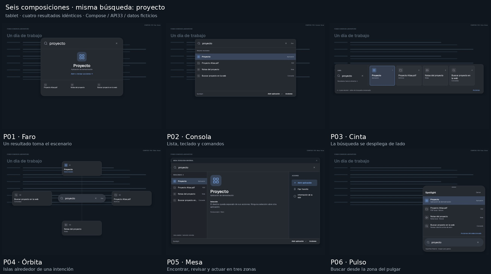

# Seis formas de imaginar Spotlight — laboratorio visual

[Galería offline autocontenida](verification/creative-directions-20261108/Galeria-Spotlight.html)
· [Comparación en teléfono](verification/creative-directions-20261108/Comparacion-phone.jpg)
· [60 PNG originales](verification/creative-directions-20261108/originals)

Exploración solicitada por el propietario desde PR21/98ba667. La decisión posterior
libera la dirección creativa: Raycast/Spotlight/Alfred son referencias, no seis
clones obligatorios. Sustituye el abanico estético E01–E12 como propuesta vigente;
**el catálogo de 36 funciones queda íntegro**. Nada está aprobado para producción.

## Qué cambia de verdad

| Propuesta | Estructura | Selección, acciones y contexto |
|---|---|---|
| P01 Faro | Un resultado protagonista y alternativas secundarias | La selección ocupa el centro; el detalle reemplaza al protagonista |
| P02 Consola | Una sola familia de lista compacta con footer estable | Menú sobre la lista; detalle temporal reversible |
| P03 Cinta | Asa estrecha que abre una franja horizontal | Tarjetas en secuencia; bandeja/cajón que crece debajo |
| P04 Órbita | Módulos separados alrededor de la búsqueda, sin panel exterior único | Selección espacial; acciones en constelación e isla que se amplía |
| P05 Mesa | Lista/raíl, escenario de destino y carril de herramientas | Contexto y controles separados; en móvil raíl lateral y mesa de destino |
| P06 Pulso | Superficie flotante inferior; búsqueda cerca de la base | Crece hacia arriba, conserva la búsqueda y usa acciones táctiles |

Se comparte una paleta neutral y el mismo fondo para que la diversidad no dependa
de cambiar colores, blur, bordes o fuentes. Las diferencias son de silueta,
proporción, orientación de resultados y recorrido. No hay pestañas/categorías
obligatorias. El orden del fixture no se recalcula ni introduce otro ranker.

## Comparación reproducible

**60 capturas Compose reales**, no renders de IA ni APK instalada: seis propuestas
× dos perfiles × cinco estados. Tablet1200×800dp y teléfono412×860dp, mdpi/API33,
misma consulta «proyecto», cuatro IDs fijos, mismo orden/selección. Inicio está
vacío; búsqueda/selección/acciones usan el primer resultado, contexto el segundo
(PDF ficticio). En Cinta móvil se conserva el carril de cuatro resultados, aunque
no todos caben simultáneamente. Esto es una diferencia intencional y un coste.

Las clases de laboratorio dibujan su propia presentación en Compose. Sólo
reutilizan tipos Result/Action, tema/fuente y vectores ya presentes. No registran
nuevos ejecutores ni modifican SearchEngine/NativeLaunchSession. Elegir una acción
sólo escribe «Prototipo… Sin ejecución externa» en estado de prueba. No se llama
startActivity, SAF, OCR, C5 ni servicios. El documento contextual es texto fijo
rotulado, no extracción ni referencia/página inventada.

La galería presenta primero las seis juntas; permite ampliar estados, comparar dos
lado a lado, ocultar rótulos externos y guardar elección local en JSON. No hay
backend, envío de selecciones o assets necesarios por red. El HTML no va al APK.
Las transiciones se describen como intención; los PNG son estados Compose, no una
animación ni comprobación de WindowManager/IME. No se afirma rendimiento físico.

## Descartes por similitud

1. Catálogo anterior: doce acabados con demasiada estructura compartida. Conservado
   como historial, sin alterar sus fuentes ni las 36 fichas funcionales.
2. Spotlight literal + Alfred literal + otra lista: tres cajas con búsqueda arriba
   y resultados debajo. Se conserva una sola lista (Consola); las demás pasan a
   protagonista y franja horizontal. [Capturas de referencia descartadas](verification/creative-directions-20261108/discarded).
3. Cápsula sobre una cuadrícula: otra expansión rectangular, demasiado cercana a
   Faro y a una consola con tarjetas. Reemplazada por Órbita sin panel exterior.
4. Mesa móvil con lista grande: parecía Consola estirada y dejaba espacio vacío.
   Se reemplaza por raíl de resultados y vista de destino/acciones simultánea.

La evaluación de semejanza es cualitativa a partir de las capturas, no una cifra
inventada. geometry.json conserva contenedores medidos; las seis combinaciones de
posición/tamaño de búsqueda son distintas en ambos perfiles, pero eso no sustituye
el juicio visual. Las láminas son composiciones etiquetadas de los PNG originales,
sin alterar su UI; no se presentan como una sola pantalla del producto.

## Recomendación

**Galaxy Tab A9+: Mesa**, si la prioridad es revisar contenido y actuar en una
superficie de trabajo. Hace útil el ancho con tres responsabilidades distintas.
Su coste es ocupar más pantalla cuando sólo se busca abrir una aplicación.
**Consola** es la alternativa más contenida y consistente para uso rápido/teclado.

**Motorola G86 5G: Pulso**, por búsqueda baja y expansión hacia arriba. Es una
hipótesis ergonómica, no una prueba física: el IME, los gestos de sistema, el
arrastre del asa y el scroll deben validarse antes de adoptarla.

Faro favorece intención dominante; Cinta favorece poca altura; Órbita es la opción
más experimental y no la adoptaría sin validar navegación espacial/accesibilidad.
Las ventajas, inconvenientes y adaptación de cada una están en la galería.
No implementar automáticamente estas recomendaciones ni crear modos nuevos.

## Investigación y validación

Referencias oficiales consultadas: Apple Spotlight, Raycast Action Panel, Alfred
Appearance, Microsoft PowerToys Run y Android Compose Bottom Sheets. Se extraen
principios, sin copiar código/assets. Linear no estuvo accesible y no cuenta como
fuente examinada. URLs, títulos/estado de acceso en references.json.

Tres escenarios de banco correctos: matrices tablet/teléfono y navegación local
con foco explícito (selección, Tab/Escape, consulta retenida y recibo honesto sin
Activity externa). Tras revisar Mesa móvil, se repiten únicamente sus cinco PNG
móviles y el escenario de interacción: dos casos correctos. No son cinco pruebas
productivas distintas ni sustituyen pruebas de teclado/overlay físicas.

Chromium/Playwright: las60 imágenes decodifican sin red; seis tarjetas al inicio,
cinco estados, zoom, comparación, ocultar rótulos y selección/exportJSON correctos;
sin errores JS ni overflow390px. Documento exacto probado con set_content, no
navegación file:// del navegador administrado.

## Preservación y entrega

Delta productivo **cero** contra98ba667. FocusStudio, Preview69, C2, C5, ranking,
140ms, preferencias, firma, paquete, versión, manifiesto de entrega, dependencias
y catálogo funcional intactos. Sin APK/testAPK/Actions/instalación. Sólo un banco
nuevo app/src/test y documentación/evidencia. No suites históricas ni lint global
repetidos. Referencias68/69 y main se conservan; PR21 borrador.

Entrega local: /workspace/shared/downloads/spotlight-otras-formas. Galería HTML,
PDF-resumen8p, láminas comparativas y originales. Reproducibilidad/hashes en
verification/creative-directions-20261108. Próximo: evaluación del propietario;
ninguna selección constituye autorización de efectos externos o entrega APK.
