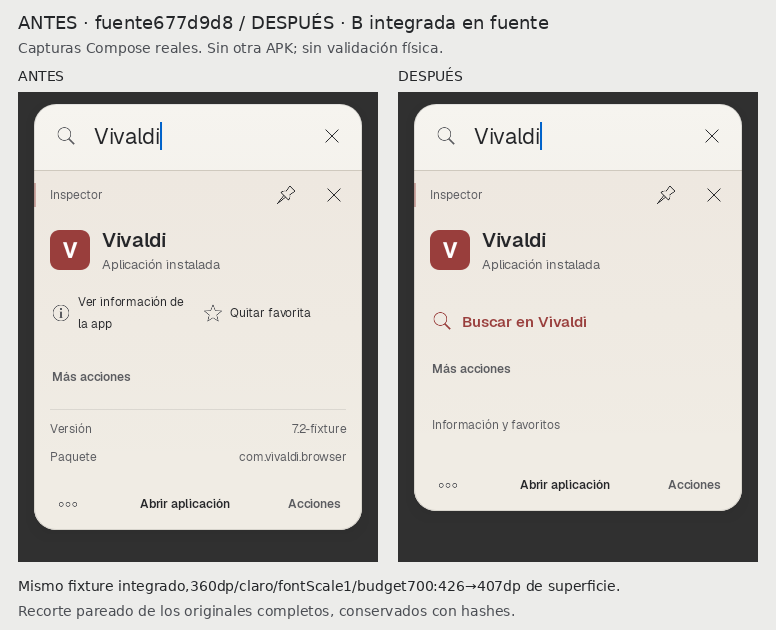
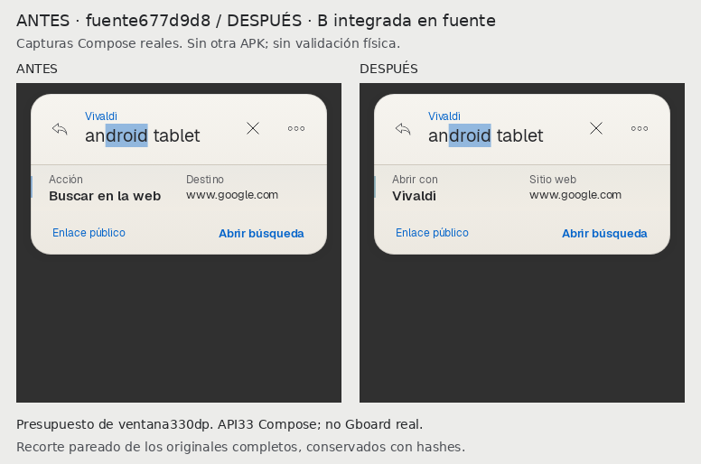

# Focus B · integración aprobada desde Preview64

**Completada en fuente**, sin otra APK ni Actions. Base677d9d848351581a602843c1e38859757efa1b62,
rama feat/preview57-native-return-20261103, PR21 borrador.
Implementación/pruebas congeladas: **8f6a5b470310b59c4f5950870ce81327a546e947**.
La aprobación del propietario cubre ambasB; no activa Focus por defecto ni autorizaC3/C4.

## Resultado

- InspectorFocus promueve la búsqueda sólo si AppCapabilities la publica actualmente.
  Al pulsar, `prepare` revalida capacidad/destino; si fue revocada no abre el formulario
  ni una alternativa. La búsqueda promovida no se repite en Más acciones.
- Información, favorito y metadatos permanecen en «Información y favoritos»,
  plegable48dp con estado accesible y recuperación. Los controles multimedia reales
  y las demás capacidades no se trasladan a esa administración.
- El ActionPanel comparte la identificación de capacidades para deduplicar y
  revalida su preparación. Conserva entrada por Ctrl+K, foco y Escape.
- RevisiónFocus: «Abrir con» usa el paquete real del Intent ya preparado y su
  nombrePackageManager; «Sitio web» muestra el host. Una acción sin receptor
  explícito dice «Predeterminada de Android». SinURL conserva «Destino».
  No se cambia el plan, Intent, fallback, confirmación, actor ni footer.
- Se corrigió una carrera pequeña relacionada: al restaurar el inspector, un
  lote vacío/intermedio eliminaba su identidad antes de completarse la búsqueda.
  LaUIFocus espera una selección válida y no está cargando antes de reconciliarla.
  Motor/ranking/savers/NativeLaunchSession no se modifican.
- Focus=false por defecto y retorno al recorrido anterior preservados. La corrección
  de contacto homónimo df5bd77 y su regresión permanecen idénticas y verdes.

## Antes/después reales

[Galeríaautocontenida](verification/focus-b-integration-20261105/antes-despues.html)
· [PDFbreve](verification/focus-b-integration-20261105/Focus-B-Integrada.pdf).

Escena móvilclaro de producción: **426→407dp de superficie**, width360dp,
fontScale1, presupuesto700dp y los mismos datos/selección/favorito. El antes es
el renderE1–E5 archivado, con componentes byteidénticos a677d9d8; el después
se obtuvo del mismo test actualizado. No es una reducción medida enOneUI.

Además se capturaron8pares frescos de SpotlightPanel real antes/después desde
677d9d8,360/960dp,claro/oscuro,presupuesto330dp. No son los prototipos de revisión.
24PNG originales completos con hashes y9láminas comparativas; los recortes de las
láminas son iguales en ambas columnas y no sustituyen los originales.
IconosAndroid/monogramas son fixtures PM explícitos, no marcas auténticas.

En330dp y fuenteAndroid200%, el inspector usa scroll para acceder a controles
con targets≥48dp; el footer permanece dentro de la ventana. La etiqueta visible
del footer puede abreviarse; su texto semántico/acción se conserva. No se reduce
la fuente para hacerlo caber. Capturas200% después del scroll, en ambos temas,
se muestran aparte, sin un antes a escala distinta ni simulación deGboard.

## Validación dirigida

**15casos distintos con última evidencia correcta**, en rondas acotadas:
6recorridos reales(330dp,2temas,2anchos y200%teléfono),3contratos de capacidad/
revocación/receptor,1regresiónhomónimo,1regresiónintegrada previa con Enter/retorno
/restauración/solicitud única y4tests de revisión anteriores adaptados al plegado.
No se cuentan las4capturasbaseline otra vez ni se suman históricos.

Se verifican apertura táctil de búsqueda, administración accesible tras restaurar,
una búsqueda por superficie, Ctrl+K/Escape/foco, consulta/cursor/selección restaurados,
confirmación descartada tras restaurar y cambio Focus→anterior→Focus con consulta/foco.
Una revocación entre disponibilidad y pulsación no prepara ni lanza nada.
La prueba de receptor usa un draft deliberadamente distinto del Intent: la etiqueta
sigue al plan real y éste no se modifica.

LintDebug nuevo: **0errores,26advertencias,1información**, BUILD SUCCESSFUL2m7s;
sin baseline/supresiones/dependencias nuevas. [XML/logs/comandos/procedencia](verification/focus-b-integration-20261105/README.md).
Se conservaron fallos iniciales, traza de restauración y su verde. Se corrigieron
esperas del harness para resultados/metadata/popup y foco antes del atajo; no se
ampliaron timeouts ni redujeron aserciones. No suite general ni assemble/APK.

## Límites y continuidad

Geist/materiales/iconos/barra/footer, motor/ranking, permisos, NativeLaunchSession,
WindowManager, paquete, firma, versión y manifiesto/workflow de entrega intactos.
Main/checkpoints/plan23 intactos; no se declara cerrado C0/C1/C2 físico ni C9.
LaAPK64 entregada sigue siendo808bda2: no incluye esta integración ni df5bd77.

Reserva propia codex-87df291d-22cb-40e5-a1eb-7f6e35955a6a, adquirida desde677d9d8;
publicar cierre y liberar sólo la propia con notas atómicas. No promover e38eae8.
C3/C4 son el siguiente bloque funcional según sus contratos/aceptaciones, sin
volver a rediseñar estas piezas. OneUI/Gboard/TabA9+/moto g86/TalkBack y efectos
realesSpotify/mensajes/archivos continúan pendientes. OtraAPK exige autorización nueva.
