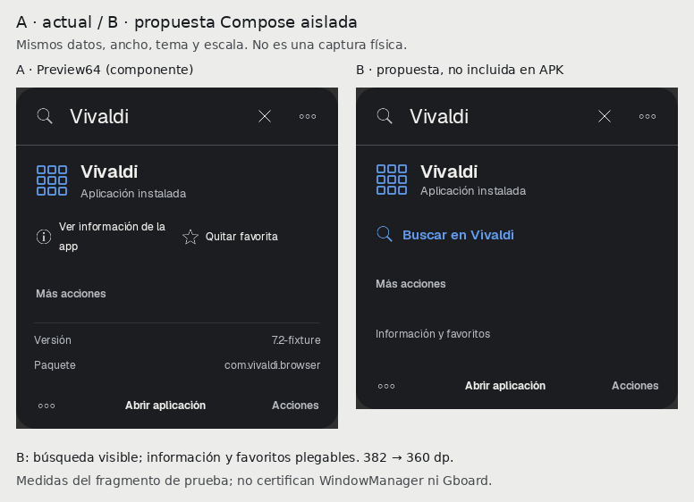
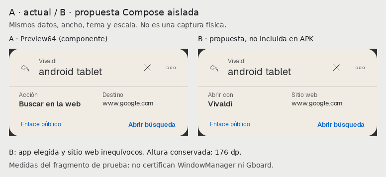

# Spotlight Focus · consolidar utilidad desde Preview64

**Veredicto:** perfeccionar Focus sobre los componentes existentes, sin otra
identidad visual. Recomiendo las dos variantes B como dirección para una integración
acotada, **no adoptarlas ni activarlas por defecto todavía**. La interfaz anterior
sigue siendo recuperación y la Preview64 no se modifica en el dispositivo.

Base verificada: PR21 abierto/borrador, rama feat/preview57-native-return-20261103,
HEAD administrativo0fa67813f7ea8f461f1d8f21502bfe8f8f008c66, fuente ejecutable64
808bda2c25887d14b42665dea4c254181d72b837. Se leyeron AGENTS, notas/reserva,
C1, cierreC2, E1–E5, entrega64 y plan maestro23. Reserva libre al iniciar;
propietario propio nuevo codex-f1eae2fd-6eda-4cfa-ae7c-a7b404d4458b.

## Qué cambió y qué se detiene para decidir

- **Corrección funcional aplicada:** seleccionar otro contacto/número invalida la
  revisión anterior. Reproducida roja sobre la base y verde tras una sola línea
  de producción; commit df5bd778019e1dc16a56c41ca8f8ad9ea4525652. No añade mecanismos,
  permisos ni capacidadesWhatsApp. Fuente para una futura entrega, no incluida en64.
- **B visuales sólo en tests:** búsqueda visible en inspector con administración
  plegable; revisión distingue app de sitio web. No se cambian fuentes/tokens,
  paleta, iconos productivos, footer, barra, búsqueda ni navegación global.
- **Pausado hasta decisión:** integrarB en producción, adoptar Focus por defecto,
  C3/C4 productivos y otra APK. No Actions, merge, main, firma ni paquete nuevos.

## Diagnóstico priorizado

| Prioridad | Evidencia concreta | Consecuencia | Decisión |
|---|---|---|---|
| P0 · revisión del destinatario | En MessageEditor, al pulsar un homónimo se cambiaban selected/address sin invalidar confirming. La regresión encontró la tarjeta de confirmación anterior todavía abierta | Podía prepararse otro destinatario sin una nueva revisión explícita | Corregido y probado sin enviar; conservar rojo y verde |
| P1 · descubrir la acción útil | Inspector Vivaldi/WhatsApp de E1–E5 muestra información/favorito; buscar/preparar queda entre resultados o Más acciones | La app parece una ficha administrativa antes que una herramienta; cuesta encontrar qué hacer | B promueve sólo la búsqueda ya disponible y pliega administración |
| P1 · destino ambiguo | Revisión Vivaldi: cabecera Vivaldi, columna «Destino: www.google.com» | No distingue aplicación receptora del sitio consultado | B dice «Abrir con: Vivaldi» / «Sitio web: www.google.com»; no cambia Intent ni fallback |
| P2 · evidencia incompleta | La captura focus-content de actions usa spotlight-root mientras ContextActionSurface abre otra ventana | El popup no aparece en ese PNG; sería falso diagnosticar que faltan acciones | Nuevas capturas del ActionPanel real, con prueba de teclado; WM físico sigue pendiente |

No detecté una razón comprobable para cambiar otra vez tipografía o paleta.
La reducción de espacio debe acompañar tareas útiles; no rellenar la columna
izquierda con sugerencias inventadas ni cambiar ranking para «equilibrar» la imagen.

## Comparativas para el propietario

[Abrir galería interactiva autocontenida](verification/focus-consolidation-20261105/comparativas.html)
· [PDF breve](verification/focus-consolidation-20261105/Revision-Focus-Preview64.pdf).
Ocho pares: teléfono360dp y fragmento de inspector tablet470dp, oscuro/claro,
misma consulta/destino/escala/datos.18PNG originales nuevos, con hashes.

A usa componentes actuales (`ApplicationInspector`, barra, revisión y footer).
B es una composición Compose aislada de esos elementos/principios, sólo en
app/src/test. No es una captura de una APK con B integrada ni una validación de
WindowManager. Los iconos genéricos son fixtures Android, no iconos deVivaldi real.
Las capturas E1–E5 archivadas tienen código visual equivalente a64; algunas
muestran todavía versión63 en Ajustes. Se conservaron sin retocar ese texto.

### 1 · Buscar antes que administrar

A mantiene controles administrativos y metadatos siempre visibles. B muestra
«Buscar en Vivaldi», conserva Más acciones y pliega información/favoritos.
**382→360dp en el fragmento medido**, con target de búsqueda≥48dp. Datos e iconos
son equivalentes. La primera prueba que sólo añadía una fila medía438dp y se
descartó; se conserva en additive-trial para no perder la decisión.

VentajaB: tarea útil disponible sin explorar primero. Coste: un toque adicional
para información/favoritos; hay que confirmar que ese coste resulta aceptable.
La integración deberá usar AppCapabilities.available/prepare reales y deduplicar
la búsqueda promovida por id, sin repetirla en Más acciones. El prototipo no
cambia el catálogo productivo ni acredita ese wiring. No prometer22dp menos en
la ventana completa: el padre, lista y presupuestoIME también determinan su altura.

### 2 · App y sitio web inequívocos

**176→176dp**: misma consulta, misma instancia de plan preparado, mismo botón y
misma ruta. Cambian las dos etiquetas de revisión. No se añaden pasos, otra barra,
cuenta ni red por tecla. La prueba conserva el plan al cambiar A/B y lo invalida
al editar; el callback de prueba está interceptado y no lanza Android.

RecomiendoB: aclara una decisión funcional sin aumentar la superficie. No se
suprime la revisión ni se presenta el dominio como identidad del receptor Android.

## Revisión por superficie

| Superficie | Estado real y propuesta |
|---|---|
| Barra universal | Entrada única global/contextual; mantener22/20sp y recuperación. No otra pestaña ni motor. El control de regreso sigue visible y contextual |
| Resultados | Exacto primero; tres sugerencias útiles como máximo y como máximo una app en inicio. El único Spotify de la captura es intencional, no un hueco que rellenar. Preservar keys/selección/LazyListState |
| Inspector | Mayor problema de descubribilidad y datos administrativos dominantes; compararB sin globalizar geometría antes de330dp/dispositivo |
| Búsqueda contextual | B separa app/sitio; borrador/cursor/selección conservados por el propietario actual. No restaurar confirmación ni ejecutar al volver |
| ActionPanel | Captura de componente corregida. Tab/Shift+Tab/Enter/Escape probados; no rediseñar el foco visible sin necesidad. Popup/IME/OEM aún físico pendiente |
| Ajustes | Ocho áreas, búsqueda y preferencia Focus reversible existentes. Mantener ubicación/persistencia y controles; texto «revisión integrada» honesto hasta adopción. No otra pantalla de modos |
| Footer | Discreto, acción contextual y48dp existentes. No añadir cápsulas ni cambiar Enter/Tab/Esc. «Ejecutar» deshabilitado en la ventana base mientras un popup está abierto no demuestra acción rota |
| Tipografía/iconos | Geist jerarquiza consulta/resultado; títulos15/21 y etiquetas12 en Focus. No sustituir identidad de apps PM. Catálogo iOS y atribución conservados; ninguna fuente/dependencia nueva |
| Contraste/táctil/teclado | Un caso existente verifica ajuste de acentos≥4.5 en materialesFocus y ambos temas. No es auditoría física de wallpaper/transparencia/TalkBack. Target nuevo≥48dp, foco/traversal y retorno probados en fixtures |

## Estado real de checkpointsC0–C9

| Checkpoint | Estado técnico | Qué falta para aceptarlo |
|---|---|---|
| C0 · referencia/estabilidad | Referencia/firma/procedencia64 comprobadas | OneUI/Gboard, métricas frías/p95/memoria y dispositivo; no hay línea base física cerrada |
| C1 · arquitectura/basevisual | Implementado con pruebas, incluido en64; E1–E5 añadeFocus reversible | Aceptación visual y física; modularización incremental, no reescritura |
| C2 · contextual/compartir | Cerrado técnicamente en alcance documentado; incluido en64 | Receptores/grants/efectos reales, IME/rotación y aceptación física |
| C3 · WhatsApp | Base previa existente; defecto menor corregido ahora. Diseño/contratos nuevos preparados | C0/C1/C2 físicos, decisión visual y autorizaciónC3a; cuentas/envíos separados |
| C4 · Spotify | Adaptadores/OAuth/AppRemote/MediaSession existentes; diseño de estados preparado | Autorización y prueba con cuenta/dispositivo; no se demostró audio por JVM |
| C5 · citasdocumentales | FileIndex/SAF/OCR/QuickLook existentes | Citas estructuradas/procedencia/página demostrable y sus pruebas; no iniciado como checkpoint |
| C6 · IAoperativa | Tools/planes/contexto existentes | Recorrido compuesto revisado y efectos consentidos; depende de contratosC3/C5 |
| C7 · Cast/sistema | Controles Android/medios previos parciales | Cast autorizado, compatibilidad, dispositivos y estado observado; no implementado como checkpoint |
| C8 · AppFunctions | Pendiente de estudio | Viabilidad real de API/privilegios; no prometer integración universal |
| C9 · consolidación/rendimiento | No cerrado | Aceptación transversal física/accesibilidad y métricas comparables; no candidate estable |

E1–E5 es integración técnica reversible en64; no sustituye esos checkpoints ni
convierte sus fixtures en aceptación. C3→C4 conserva la secuencia pedida.

## Las23mejoras siguen en el plan

| ID | Estado desde64 y esta revisión |
|---|---|
| F01 · integraciones | C2 público acotado; profundidad verticalC3/C4 pendiente |
| F02 · WhatsApp | Base existe; invalidación del contacto corregida; C3 pendiente |
| F03 · Spotify | Adaptadores existen; observación y cuenta físicaC4 pendientes |
| F04 · Cast | C7 pendiente; sin SDKnuevo |
| F05 · citas | Índice/OCR existentes; citasC5 pendientes |
| F06 · IAoperativa | Tools existentes; recorridoC6 pendiente |
| F07 · contextual | C2 técnico implementado, físico pendiente; exacto preservado |
| F12 · sistema | Controles existentes parciales; C7 sin cerrar |
| F14 · compartir | C2 técnico, aceptación de grants/receptores y cadenasC6 pendientes |
| F15 · AppFunctions | EstudioC8 pendiente |
| V01 · materiales | C1/E1–E5 presentes, sin nueva paleta ni adopción globalFocus |
| V02 · inspector | Existente; B de jerarquía pendiente de decisión |
| V03 · acentos | Localizados con ajustecontraste; dispositivo pendiente |
| V04 · resultados | JerarquíaFocus existente, ranking intacto; no nueva densidad impuesta |
| V05 · footer | Contextual existente, sin rediseño nuevo; físico pendiente |
| V06 · ventana | Arreglos anteriores incluidos; OneUI/Gboard no aceptados |
| V07 · iconos | Catálogo/atribución existentes; PM para apps, sin nuevos assets |
| V08 · contenido | Vistas existentes con estados/fixtures honestos; cuentas/documentos reales pendientes |
| V10 · motion | Transiciones/reducción existentes; fluidez física sin medir |
| S01 · OneUI | Pendiente físico |
| S02 · modularización | Parcial/incremental; no segundo framework ni engine |
| S03 · diagnósticos | NativeLaunchSession/contratos existentes; C3/C4 precisan estados de su dominio |
| S04 · rendimiento | Pendiente medir; duraciones de JVM no son latenciaAndroid |

No se incorporan F08/F09/F10/F11/F13/V09 ni se borran sus implementaciones previas.

## Verificación y siguiente implementación acotada

11casos JVM distintos verdes:4perfilesA/B,2ActionPanel,1contraste,1contacto,
2contratosReplyConfirmation y1restauraciónC2. Se conserva el rojo de contacto,
el fallo inicial de compilación del nuevo harness y el selector ambiguo de pruebas;
no se debilitaron aserciones ni aumentaron timeouts. Lint nuevo0E/26W/1Info.
No suite integral, APK, Actions, cuenta real, envío ni aceptación física.

[Evidencia/comandos/procedencia](verification/focus-consolidation-20261105/README.md)
· [Diseño y contratosC3/C4](C3-C4-CONTRACT-DESIGN-20261105.md).

**Decisión solicitada:** aprobarB del inspector (con administración plegable) y B
de revisión contextual, sólo para una integración opt-in posterior. Si se aprueban,
el siguiente cambio se limita a esas dos piezas, disponibilidad/deduplicación y
pruebas330dp/textoampliado/retorno/teclado. No cambiar Focus=false por defecto aún.
Si se prefiereA, se conserva; la corrección funcional del contacto es independiente.
La adopción como principal exige además aceptación física64 y prueba de reversión.
