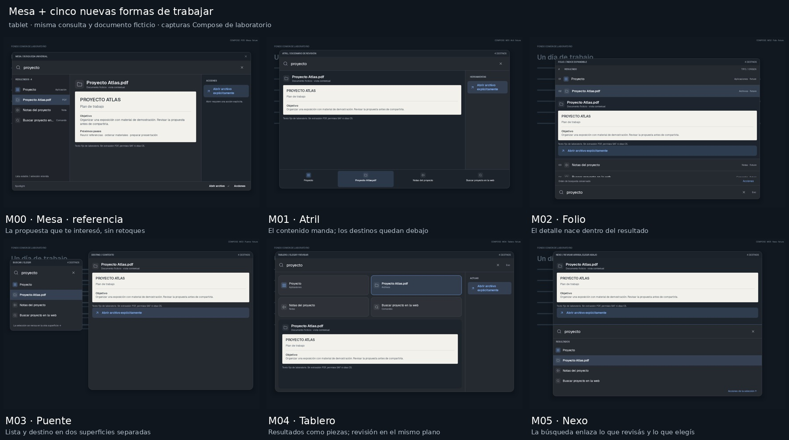

# Mesa interesó: cinco caminos nuevos, sin adoptar todavía

[Galería offline](verification/mesa-explorations-20261108/Galeria-Spotlight.html)
· [Teléfono](verification/mesa-explorations-20261108/Comparacion-phone.jpg)
· [Originales](verification/mesa-explorations-20261108/originals)

El propietario pidió más propuestas y señaló interés en Mesa. Eso fija una pista
de exploración, **no aprobación para integrar**. Se conserva M00/P05 como referencia
exacta y se exploran cinco formas de repartir resultados, revisión y acciones:

| Código | Propuesta | Diferencia estructural |
|---|---|---|
| M00 | Mesa, referencia | Lista izquierda, destino central y acciones derecha; original intacta |
| M01 | Atril | Contenido protagonista y resultados en un dock inferior |
| M02 | Folio | El contenido se despliega dentro de la fila; búsqueda abajo |
| M03 | Puente | Lista y destino en superficies separadas, con fondo visible entre ellas |
| M04 | Tablero | Cuadrícula de destinos sobre un área de revisión y acciones separadas |
| M05 | Nexo | Contexto arriba, consulta en el medio y lista debajo |

Para continuar mirando, recomiendo **Puente** y **Atril**. Puente separa encontrar
y revisar sin meterlo todo en una caja; Atril prioriza lectura/contenido sin perder
las alternativas. Mesa sigue siendo candidata. No se descartan sus cualidades por
hacer otra ronda ni se crea una nueva preferencia/mode en la aplicación.

## Comparación y límites

50 capturas nuevas de Compose/API33: cinco propuestas × dos perfiles × cinco estados.
Se reutilizan diez PNG de Mesa P05 como M00, **byteidénticos**, con origen/hash en
reference-reuse.json; no se vuelve a renderizar ni se retoca esa referencia.
Total de la galería:60. Tablet1200×800dp y teléfono412×860dp, misma paleta/fondo,
consulta «proyecto», cuatro IDs/orden fijos. No son capturas físicas ni renders de IA.
La comparación abre en el estado contextual para mirar el documento elegido; puede
cambiarse a inicio, búsqueda, selección o acciones. La cantidad de texto de ejemplo
visible varía por espacio/representación, no son documentos personales diferentes.

Los prototipos están aislados en MesaExplorationsGalleryTest. Reutilizan tipos
Result/Action y ayudas de presentación de laboratorio, no el motor de ejecución.
El documento es texto fijo rotulado, sin extracción PDF/SAF/OCR/C5. Las acciones
sólo producen un recibo local «Prototipo… Sin ejecución externa». No startActivity,
servicios, descargas de modelos ni integración con apps reales.

Puente es una sola composición con dos piezas dibujadas; no se implementaron dos
ventanas WindowManager ni servicios. Passthrough de toques, IME, gestos, accesibilidad,
texto ampliado y rendimiento requieren validación antes de una implementación.
Las transiciones descritas son intención, no una animación física medida.

## Evidencia y conservación

Tres escenarios de banco correctos: matrices tablet/teléfono y navegación local
con foco explícito, conservación de consulta/selección y ninguna Activity externa.
Revisión visual encontró herramientas demasiado bajas en un estado móvil; se
compactó sólo la presentación de acciones. Se repitieron únicamente los diez PNG
de acciones y el escenario de interacción, con tres casos correctos (mismos nombres,
no seis pruebas productivas distintas). Las demás capturas se conservaron.

Chromium:60imágenes offline, seis propuestas juntas, zoom, comparación, cinco estados,
selección/exportJSON y sin errores JS/overflow390px. HTML entregado reproducido
byte por byte desde PNG versionados, sin Gradle. No se repiten suites históricas
ni lint global: delta productivo cero.

Se preservan contra25051d29d6927bfed90d3a105510a3d3339084ce: app/src/main,
Gradle/manifest de entrega/workflows/permisos/dependencias/firma/versión, FocusStudio,
Preview69, C2, C5, los seis conceptos anteriores y el catálogo36funciones. Sin APK,
testAPK, Actions, instalaciones o cambios de main. Autorización69 consumida.
PR21 borrador; publicar checkpoint y liberar sólo reserva propia.

Entrega: /workspace/shared/downloads/spotlight-mesa-mas, galería HTML/PDF8p/láminas/
originales. La galería de seis conceptos anterior continúa disponible y las fichas
funcionales no se reemplazan. Próximo: elección del propietario, no implementación.
