# Preview61 — preparación de validación física C1

Actualización posterior: [Preview61 entregada y verificada](NATIVE61-DELIVERY-20261104.md).
La autorización posterior y el procedimiento vigente están en
[política de entrega](PREVIEW-DELIVERY-POLICY.md); los bloqueos de preparación
que siguen describen la etapa histórica previa.

Estado: preparación autorizada; NO autoriza compilar, firmar, ejecutar Actions,
instalar ni comenzar C2. Base exacta C1: 8cd43a7e3c1f01d272e214f5649d67f96ea64a3e.
La fuente candidata será el commit publicado que contiene este documento y el
cambio de metadatos; no atribuir la futura APK al SHA base de C1.

## Identidad y alcance congelados

- Paquete: dev.bautista.spotlight.next.raycastpreview.
- versionCode preparado: 61 (>60); nombre optimizado previsto:
  2.0.1-raycast-preview-native57-v61.
- Certificado SHA256 requerido:
  885838aa970e0d4ba168a2b5f3e8f1a6e7334263c34c9cbc888f5c70381a52ba.
- R8 y resource shrinking habilitados; no debuggable; ARM64; min26/target35.
- Sólo cambia la numeración Raycast en app/build.gradle.kts. release.properties,
  app/src, motores, permisos, dependencias y demás variantes se conservan.
- Se conserva C1 completo: Refinado + Adaptive, modularización, inspectores,
  selección y footer. Sin funciones C2 ni rediseño adicional.

## Procedimiento revisado y puerta de autorización

Preview60: fuente e9647c1329b93820383e3c8b4ec56dbceb3ce5f1, workflow
c6d481c1ad3f8b6765c5e412d718f703d5c9acc5, run41581584988, intento1 correcto.
Ver [entrega verificada](NATIVE60-DELIVERY-20261103.md) y
[procedimiento histórico](NATIVE60-HISTORICAL-SIGNING-20261103.md).
La nota histórica de firma pendiente fue superada por esa entrega.

native60_policy.py, native60_verify.py, native60_bundle.py y native60_sign.sh
fijan fuente/versión/nombres60; build-apk.yml ofrece native60-once, no un modo61.
No ejecutar esos helpers sobre61, ni reabrir el intento60, ni alterar sus guardas.
Ningún workflow/helper de firma se modifica en esta preparación.

Ruta recomendada si se confirma presupuesto y bindings: preparar y revisar una
ruta61 separada y acotada, preservando literalmente las restricciones60. Antes de
ejecutarla debe existir un SHA de workflow revisado y autorización específica del
par SHA fuente61/SHA workflow61. Esta preparación NO es una ruta ejecutable61.
Si se prefiere firma local, comprobar primero el respaldo histórico en Termux
con el preflight ya documentado; no transferir claves ni contraseñas al cloud.
No compilar anticipadamente sin una vía de firma comprobable.

Secuencia para la futura ruta61 autorizada:

1. Verificar remoto, árbol limpio, fuente61 exacta y reserva propia nueva. Validar
   actor/ref/SHA de workflow/evento, intento1, historial sin intento previo de esa
   revisión y lease exacto antes de cada job. Tokens contents:read/actions:read;
   checkout sin credenciales persistentes; acciones fijadas a SHA completos.
2. Preflight aislado: comprobar existencia y acceso a la clave histórica y su
   certificado, sin Gradle, logs privados ni exportación de la clave.
3. Runner unsigned separado, sin secretos: JDK17/SDK35/Gradle8.10.2; un solo
   assembleRaycastPreview optimizado, worker1 y memoria controlada. No repetir
   las78 pruebas ni Lint de C1 por cambios de versión. Ante fallo R8, conservar
   evidencia y detenerse; sin retry, rerun ni fallback experimental automático.
4. Comprobar unsigned: paquete/code61/nombre/noDebuggable/SDK/ABI, zipalign16KiB,
   ELF16KiB, DEX nativo y ausencia de credenciales/puente visual WebView.
   Crear ZIP con git archive del mismo SHA y manifiesto de hashes/procedencia.
5. Firma en runner nuevo con tooling revisado, sin ejecutar Gradle ni sourceZIP.
   Validar digests y procedencia, certificado885838aa y firma v2/un firmante.
   Limpiar material privado antes de verificar y subir, con limpieza always.
6. Descargar y verificar independientemente APK/ZIP: fuente exacta, hashes,
   payload idéntico al unsigned y certificado. Entregar APK+ZIP+SHA256SUMS+
   SOURCE_COMMIT+workflow/run/perfil+informe; instalación manual opcional.
7. Cerrar con nota y liberar exclusivamente owner/lease propios de esa ejecución.

## Presupuesto: no verificado actualmente

Los198 minutos anotados en octubre y la confirmación para60 no son saldo actual.
El conector disponible no expone facturación; la auditoría60 registró403 para Usage.
Se solicita al propietario el saldo actual de minutos/almacenamiento y confirmación
de límite de gasto0/detención al límite, sin secretos. No se cambia facturación.

Referencia medida60: 12m31s de ejecución, build11m47s; APK73,414,053 bytes,
ZIP10,284,454 bytes. No es una estimación garantizada para61.
Techo propuesto si se adopta la misma separación: 5+30+10=45 minutos Ubuntu,
concurrencia1, cero escritura de caché, retención unsigned1día/final3días y margen
de almacenamiento al menos250MB. No crear ejecuciones para medir presupuesto.
Antes del dispatch: confirmar cuota suficiente y costo permitido para ese techo,
bindings históricos presentes (sin divulgar valores) y autorización exacta.
Si la vía local es viable, registrar recursos locales y no consumir Actions.

## Evidencia reutilizada y capturas antes/después

[C1: capturas Compose, XML, cobertura y límites](verification/c1-native-20261104/README.md).
78 casos distintos con última evidencia correcta; Lint0 errores/16 advertencias/
1 información. Se conserva el rojo/verde de extracción. No se ejecutan pruebas
nuevas aquí. Sólo inspección de diff/identidad; la metadata del binario queda
pendiente de compilación autorizada.

Las siguientes son capturas existentes de producción Compose bajo Robolectric
API33 NATIVE, fixtures sintéticos, escala1; NO capturas de APK61 ni dispositivos.
Antes=faf84f0 (Preview60 fuente); después=implementación C1. No se regeneran.
Las escenas de inspector incluyen búsqueda y footer. El viewport reducido simula
presupuesto de IME, no un teclado abierto real.

| Escena | Antes | Después C1 |
|---|---|---|
| Teléfono claro, búsqueda/inspector/footer | 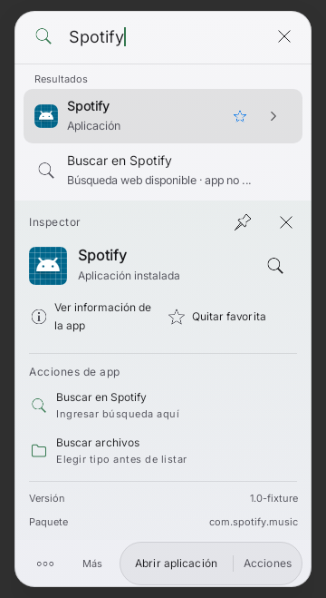 | 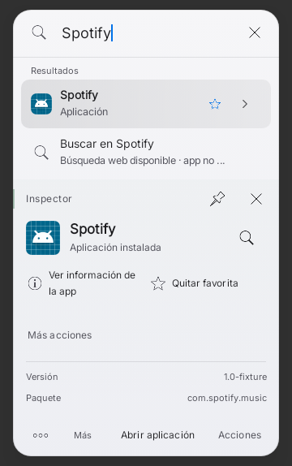 |
| Teléfono oscuro | 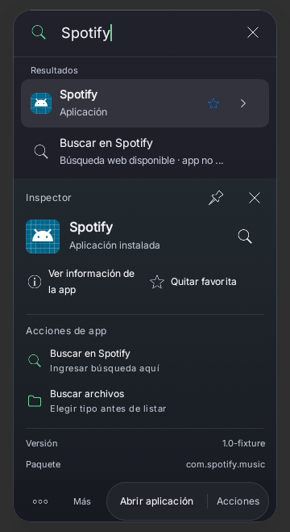 | 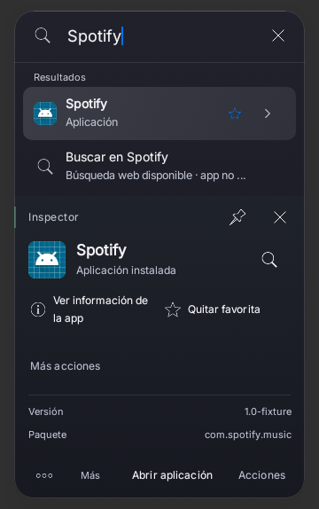 |
| Tablet claro | 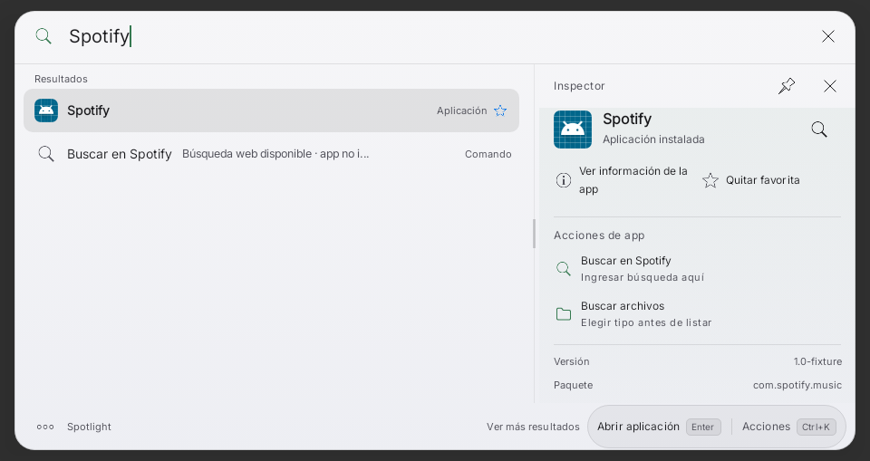 | 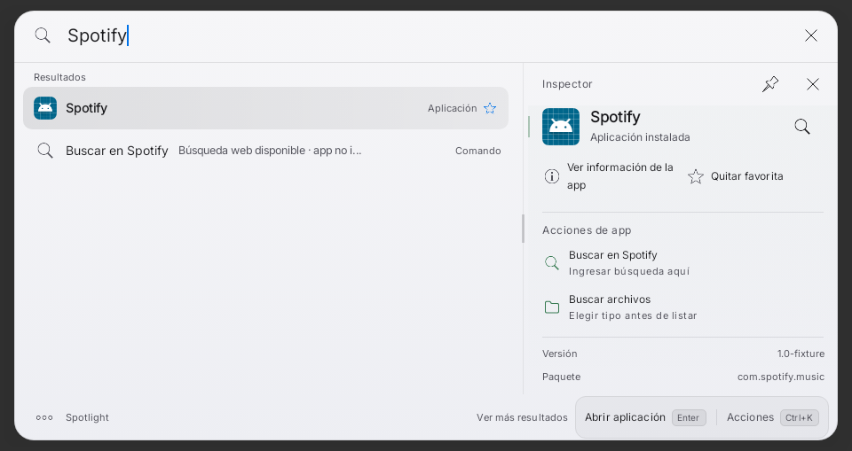 |
| Tablet oscuro | 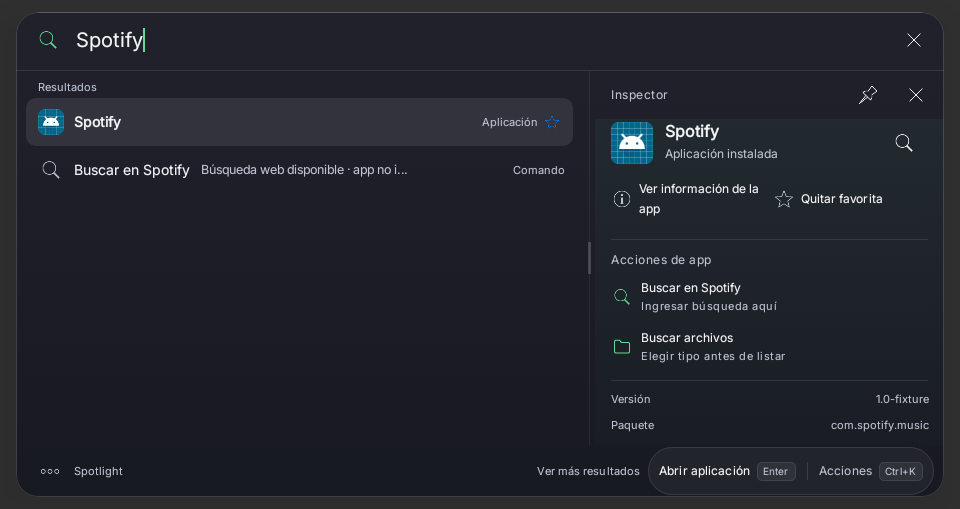 | 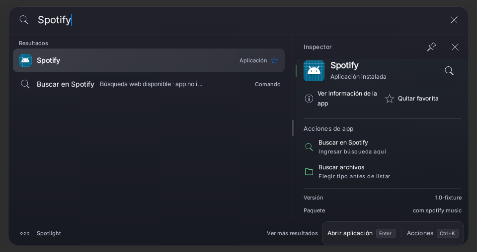 |
| Inicio/búsqueda compacta | 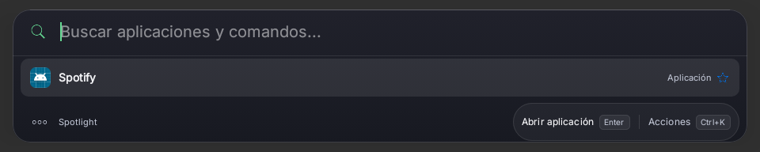 | 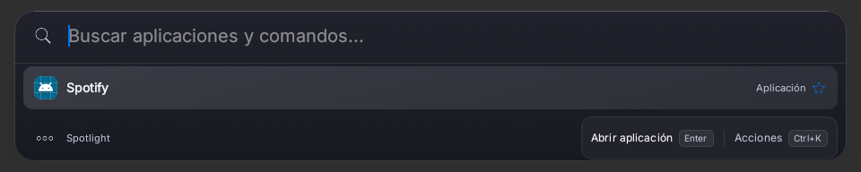 |
| Búsqueda/footer con viewport reducido | 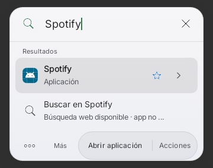 | 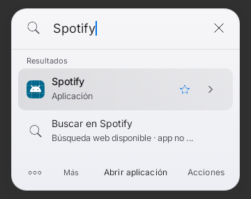 |

Los XML ResultTouchScrollTest acreditan navegación táctil en fixture: swipe,
tap, long-press, cancelación y última fila. Una captura estática no prueba gestos.
La evidencia física antes/después de navegación requiere video breve y capturas
inicial/final; queda pendiente, sin inventar imágenes ni ejecutar capturas nuevas.

## Protocolo breve A/B — Tab A9+ y moto g86

Antes de actualizar, confirmar que está instalada60 con paquete/certificado
correctos. Si no está, registrar la versión real: no llamar60 a otra instalación.
Guardar las escenas60 primero:61 actualiza el mismo paquete y Android puede
bloquear volver a60. No desinstalar, borrar datos ni forzar downgrade.

En cada dispositivo registrar Android/OneUI, orientación, escala/densidad, tema,
ancho/densidad del overlay, teclado, permisos y versión. Usar mismos ajustes,
fondo, app instalada, PDF local de prueba, consulta y selección en ambas versiones.
No capturar chats/contactos/documentos privados. Las capturas van emparejadas por
dispositivo/escena/tema/orientación/versión, sin mezclar teléfono con tablet.

| Paso | Comparación y evidencia mínima |
|---|---|
| 1. Inicio y búsqueda | Claro/oscuro: captura de inicio hasta3 sugerencias y consulta exacta de una app real; exacto primero, mismas alturas y selección estable. |
| 2. Inspector y footer | Captura de misma selección, abrir/cerrar acciones secundarias; footer alcanzable, sin columna vacía móvil, sin efectos por desplegar. |
| 3. Táctil y PDF | Video corto de swipe hasta última fila/acción, long-press y tap; scroll no abre nada, tap/acción mantienen su contrato y Quick Look no lanza externo. Capturas inicio/final. |
| 4. Teclado y rotación | IME visible/oculto, vertical/horizontal; Tab/ShiftTab/Enter/Escape/flechas y teclado físico si disponible; sin recortes, saltos ni pérdida de consulta/foco. |
| 5. Accesibilidad/estado | Texto200%, TalkBack, cerrar/reabrir y cancelar; última acción alcanzable. Alternativa/permiso revocado sin fallback automático ni consentimiento restaurado. |
| 6. Rendimiento | Mismo dispositivo y condiciones: separar apertura fría/caliente, repetir un pequeño conjunto fijo de consultas locales y ciclos abrir/cerrar; anotar tiempos y memoria con el mismo método disponible. No llamar p95 a medición manual imprecisa. |

Capturar60 antes y61 después de instalación manual autorizada y verificación de
identidad, conservando datos/preferencias/permisos. No conectar cuentas ni enviar
mensajes. Registrar por caso esperado/observado/pasa-falla/no probado, video o
captura y versión; fallos con reproducción breve. Para medir p95/memoria con rigor,
acordar instrumento y muestra antes; si no hay acceso, mantenerlos pendientes.
El10% del plan maestro es un umbral propuesto, no una medición ni aceptación.

Puerta a C2: propietario acepta visualmente61 en ambos dispositivos; no hay
regresiones críticas de foco/IME/teclado/scroll/acciones y se documentan métricas
comparables o sus límites explícitos. C0 físico no se cierra con Robolectric.
Ante fallo, corregir sólo con autorización correspondiente y evidencia dirigida;
no empezar C2 ni ocultar el problema con cambios de diseño o pruebas debilitadas.
