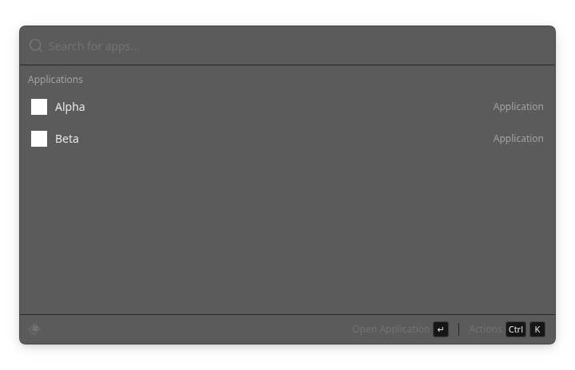
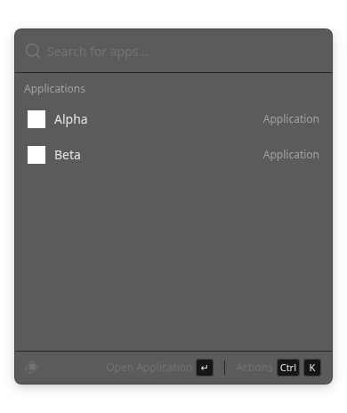

# Checkpoint 1 — contrato Kotlin–WebView

Inicio 2026-11-02; verificación final 2026-11-03 UTC. Base publicada inspeccionada:
`dbfcf81858240964812c5977612fbca86fc0d2f6`. Instalación y auditoría en commit separado
`54735009377027cca3da9954e5bbb1f296aa8d73`. Rama propia:
`feat/webview-contracts-20261102`. Main, checkpoints y checkout/PR19 conservados.

Plan de las tres capacidades: [checkpoints independientes](../../THREE-CAPABILITIES-CHECKPOINTS-20261102.md).
Contrato operativo: [Raycast v2](../../RAYCAST-BRIDGE-V2.md).

## Resultado funcional

Se conserva el transporte MessagePort local y el motor Kotlin. Se implementan
envelopes v2 tipados/validados, sesión nueva al reconectar, IDs correlacionados y
monotónicos, caché de repetición acotada y fence tras expulsión. Seleccionar es
inspect, abrir es una petición posterior explícita. Kotlin valida paquete,
actividad y selección y consume el token antes del efecto; una repetición del ID
o un ID nuevo con token consumido no vuelve a abrir. Los fallos de permiso se
devuelven sin detalles privados. `requested` describe una solicitud a Android,
no una tarea externa completada. No se reintenta al quedar un resultado desconocido.

Los resultados se invalidan desde que cambia la consulta, antes del debounce;
una generación impide publicar trabajo antiguo. Respuestas y errores se cotejan
contra la petición y sesión pendientes. Dispose, cancelación y reconexión retiran
capacidades y trabajo. Se rechazan paquetes malformados, operaciones no
implementadas, URLs de iconos y campos adicionales. El contrato de teclado de
resultados/acciones incluye flechas, Enter, Tab/Shift+Tab, Ctrl+K y Escape.

No hay catálogo ficticio en producción. Sin host Android, la UI no fabrica apps.
OpenUI, formularios generativos y RAGFlow **no se instalan ni se simulan** en esta
fase. Sus tres skills sí quedan instaladas byte por byte con las referencias del
ZIP y enlazadas desde AGENTS. Fases2/3 continúan planificadas.

## Verificación por niveles

| Nivel | Resultado comprobado | Límite |
| --- | --- | --- |
| Kotlin / Android de prueba | 20 casos únicos: LocalRaycastBridgeTest11, RaycastBridgeProtocolTest7, LocalRaycastWebViewTest2; cero fallos/errores/omitidos | Robolectric/API33, no dispositivo |
| Motor/ejecutor | Paquete registrado como instalado en PackageManager de prueba → SearchEngine real → token → inspect sin Activity → Intent exacto una sola vez | El paquete es un fixture de test; no se instala ni abre una app física |
| Transporte nativo | RecordingRaycastPort observa los paquetes reales del puente; error PERMISSION_REQUIRED sin texto de excepción | Puerto de registro exclusivo de tests; no certifica MessagePort de WebView en Android físico |
| TypeScript | 15 pruebas Vitest de límites, formas, filas, IDs, sesiones y acknowledgements | Validador real, datos adversariales de test |
| Tipado estático | tsc --noEmit --strict del módulo de protocolo, sin errores | No se presenta como vue-tsc de toda la aplicación |
| Vue / Chromium | 16 controles de navegador, cero errores JS, recursos sólo del origen local | Adaptador MessagePort sólo de laboratorio; no demuestra instalación de apps Android |
| Assets finales | 14 archivos idénticos a generate; comprobación por hashes y prueba que abre todos los bundles empaquetados desde assets Android | Repetición de los dos casos de assets, no dos casos únicos adicionales |
| Estética | CSS byte por byte idéntico; comparativas con mismo fixture, viewport y estado | Capturas de navegador, no de Android |

La primera ronda nativa preservada falló al retirar un paquete después de la
búsqueda: getActivityInfo seguía devolviendo su actividad en Robolectric.
Se añadió getPackageInfo antes del efecto, sin relajar la aserción. El resto de
las pruebas previas se migraron al envelope v2 conservando su intención; se
agregan pruebas explícitas de replay, sesión, revocación, permiso y límites.

El frontend se generó usando el lock existente tras npm ci --ignore-scripts.
No cambia package.json/package-lock ni se ejecutan hooks de skills. Los bundles
obsoletos se sustituyen por los de esa misma generación; v1 no queda activo.

## Comparativa controlada (fixtures de navegador)

| Estado inicial con dos resultados de prueba | Antes v1 | Después v2 |
| --- | --- | --- |
| 720×464 |  |  |
| 390×464 |  |  |

Teléfono:0 píxeles distintos de180960. Tablet:30 píxeles de334080, localizados en
bordes redondeados por rasterización; sin máscaras ni baseline reemplazada. Se
inspeccionan ambas capturas. Geometría, tipografía, colores y CSS conservados.
`browser/comparison.json` conserva posiciones y cifras. Los iconos/casos de
prueba son iguales en ambos adaptadores y nunca se empaquetan en producción.

Assets sin comprimir:725292 →729349 bytes (**+4057 bytes**). Dependencias nuevas:0.
Esto mide assets, no tamaño de APK; no se ensambla ni firma una APK nueva.

## Comandos reproducibles

```sh
JAVA_HOME=<JDK17> bash gradlew :app:testWebviewPrototypeUnitTest \
  --tests dev.bautista.spotlight.overlay.LocalRaycastBridgeTest \
  --tests dev.bautista.spotlight.overlay.LocalRaycastWebViewTest \
  --tests dev.bautista.spotlight.overlay.RaycastBridgeProtocolTest \
  -I scripts/directed-tests.init.gradle \
  -PspotlightDirectedClasses=dev.bautista.spotlight.overlay.LocalRaycastBridgeTest,dev.bautista.spotlight.overlay.LocalRaycastWebViewTest,dev.bautista.spotlight.overlay.RaycastBridgeProtocolTest

# Desde experiments/raycast-webview/frontend:
npm run generate
npm exec vitest run tests/native-protocol.test.ts
node node_modules/typescript/bin/tsc --noEmit --strict --target es2022 \
  --module esnext --lib es2022,dom --skipLibCheck app/utils/native-protocol.ts
NODE_PATH=<existing-Playwright-installation> SPOTLIGHT_CHROMIUM=<chromium> node tests/web-runtime.cjs

# Tras sincronizar assets:
bash gradlew :app:testWebviewPrototypeUnitTest \
  --tests dev.bautista.spotlight.overlay.LocalRaycastWebViewTest
bash gradlew :app:lintWebviewPrototype
```

JDK17.0.21, SDK/Build Tools35 y Gradle8.10.2. XML/logs de la cohorte nativa,
fallo inicial, validador TS, generación, navegador, hashes y gate de assets
conservados en este directorio. No sumar repeticiones como casos nuevos.

## Pendiente y límites

Prueba end-to-end con **WebView Android real**, overlay/IME, rotación, teclado
físico, renderer real y mediciones de arranque/memoria. La entrega58 previa
documentada pertenece a8c7128e y no contiene estos cambios; no se afirma otra APK
firmada ni se reutiliza ese número como si certificara el HEAD actual.

No se modifica Spotify/WhatsApp/PDF ni se transmiten documentos. Se preservan
FileIndex, su recuperación semántica local, SAF/OCR, Quick Look y DirectAi.
Las fases2/3 requieren sus propios criterios, y el servidor remoto RAGFlow
requiere autorización/configuración separada. No se ejecutan Actions, merges,
servidores pesados ni generación de claves.

Lint final :app:lintWebviewPrototype: BUILD SUCCESSFUL en2m09s (gate conjunto de tests y lint), 0 errores, 28 advertencias y 1 información; informe completo conservado.
