# C1 nativo — evidencia y alcance (2026-11-04)

Implementación autorizada: Refinado en barra/listado/estructura, Adaptive sólo
para presentación contextual existente. C0 físico **pendiente**. Sin APK,
Actions, claves, dependencias, cambio de permisos/versión o motores nuevos.

## Cambios separados

- Estructural `9bdd9d9`: presentación de resultados y etiquetas de acción fuera
  del panel raíz. Estado/búsqueda/generaciones/saveable/lanzamiento siguen con su
  propietario. No nuevo bus/ViewModel/ejecutor ni reescritura masiva.
- Base `03761d6`: selección satinada, foco de resultado 1 dp neutro (ActionPanel
  mantiene 2 dp), jerarquía, sombra/borde contenidos y dock táctil sin cápsula.
  Barra 56 dp y filas normales 48 dp inline/60dp apiladas intactas; hasta 3 sugerencias.
- Ajustes de inspector y este cierre: acento local reducido y por paquete exacto,
  encabezado semántico y acciones secundarias desplegables dentro del contexto
  compacto. Se conserva cancelación mientras se extrae y expansión al terminar,
  evitando plegado automático. Media/formularios usan controles sobrios. Se
  nombran WhatsApp personal y WhatsApp Business; **no hay selector de canal nuevo**.

No nuevas sesiones Spotify, destinatarios, citas estructuradas, ranking, Cast,
AppFunctions, IA o RAGFlow/OpenUI/WebView. Documentos conservan extracción y
Quick Look existentes; no se incorpora la cita ficticia dibujada para C5.

## Capturas reales comparables

Producción Compose, Robolectric API 33 NATIVE, paquetes/iconos sintéticos y sin
cuentas. No son capturas físicas ni medición de transparencia sobre One UI.
Mismas consultas/selecciones, ancho360/960 dp y escala 1. Presupuesto de IME reducido
simulado a 300 dp; no se abrió un teclado físico/IME real. Hashes en captures.json.

| Escena | Preview60 fuente faf84f0 | C1 después |
|---|---|---|
| Teléfono claro | 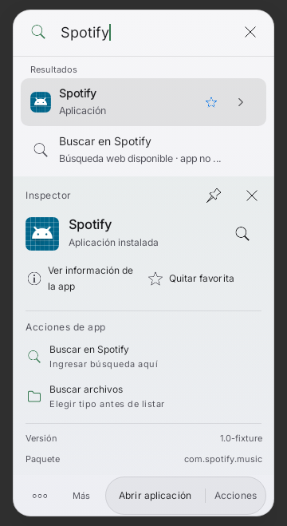 | 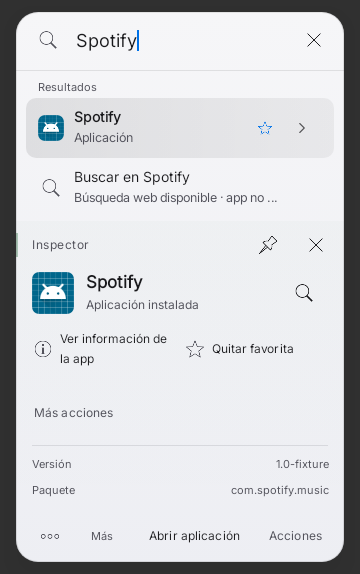 |
| Teléfono oscuro | 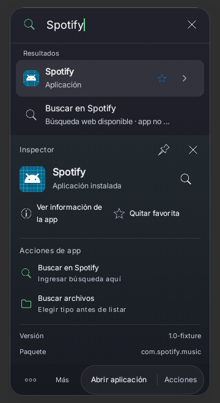 | 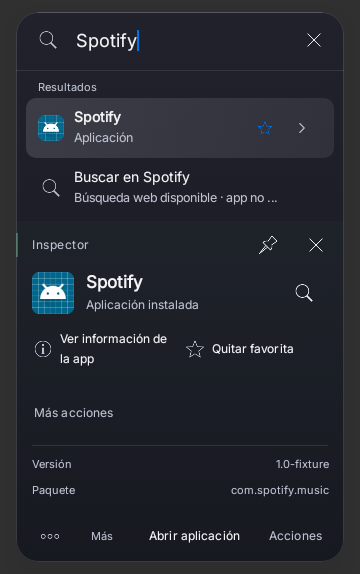 |
| Tablet claro | 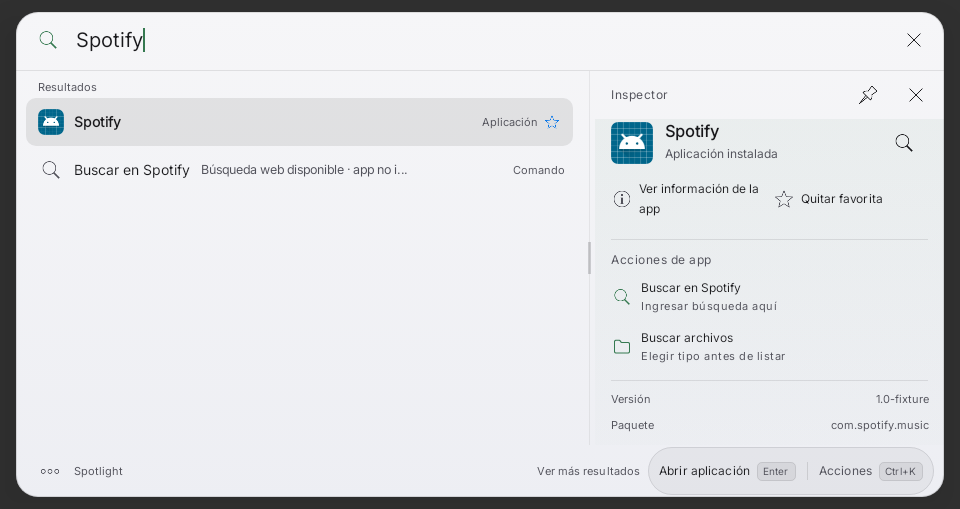 | 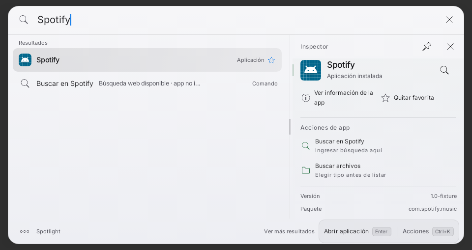 |
| Tablet oscuro | 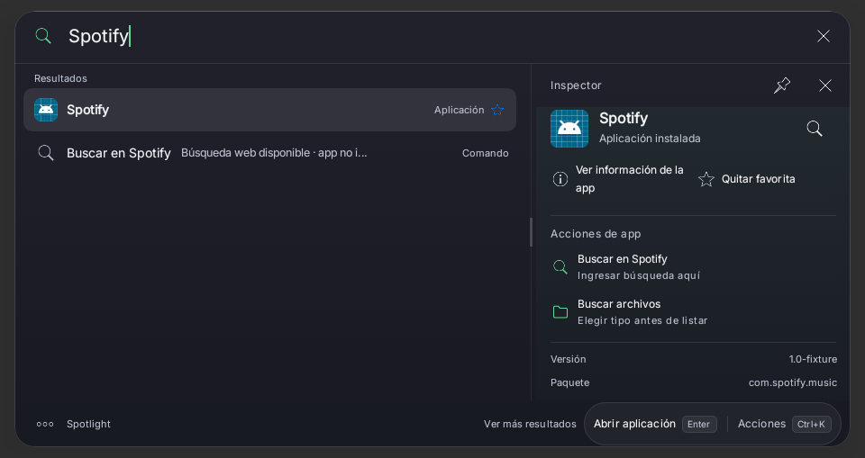 | 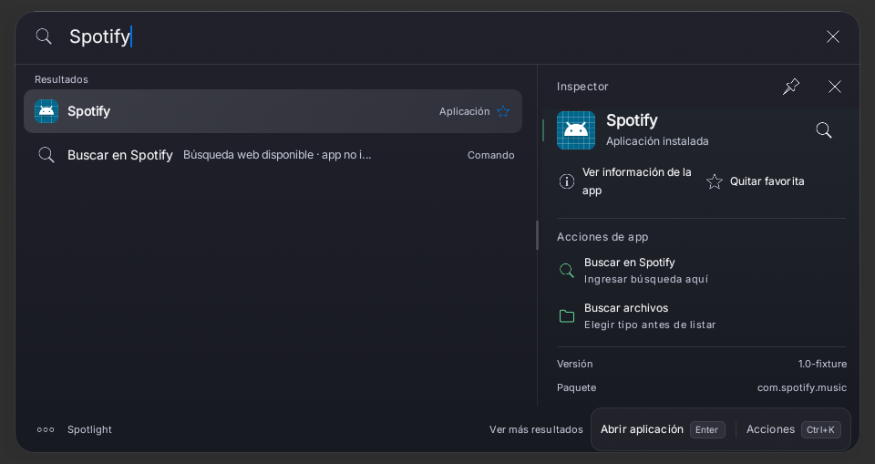 |
| Inicio compacto | 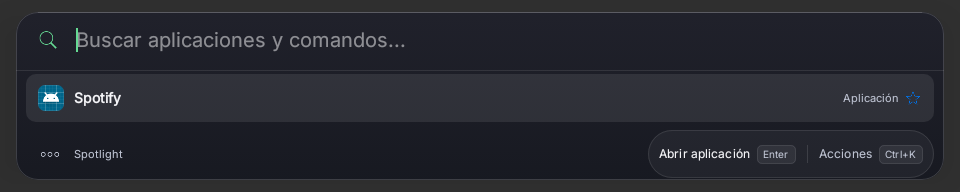 | 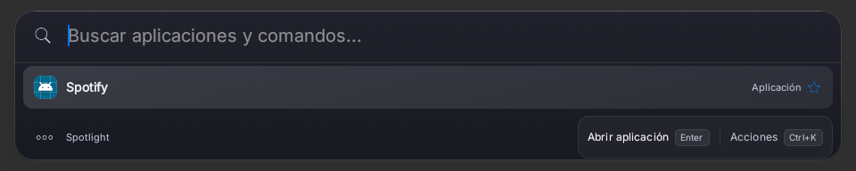 |
| Viewport reducido | 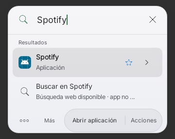 | 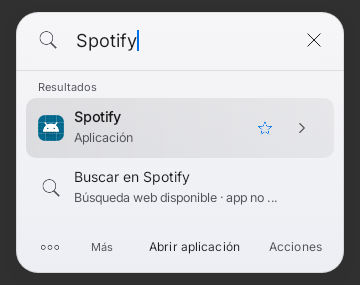 |

Las seis comparaciones antes/refactor son byte a byte idénticas una vez cargada
la versión del paquete fixture. El primer teléfono claro tomó ese dato de IO
todavía pendiente y omitió una fila; se sincronizó la captura y repitió sólo ese
caso sin cambiar producción ni enmascarar píxeles. El primer registro sigue en el
commit estructural; refactor.json conserva la aclaración.

## Pruebas ejecutadas, sin sumar repeticiones

- Baseline: 6 casos de C1SceneContractTest.
- Refactor: 26 casos (escenas, búsqueda, lanzamiento nativo y táctil).
- Base visual: 22 casos (escenas, dock, geometría, texto 200%, RTL y scroll).
- Inspectores: 50 casos, 48 correctos inicialmente; 2 fixtures nuevos de formulario
  pulsaban sin asegurar visibilidad en viewport por defecto. Se fijó viewport y
  scroll explícitos; revisión/confirmación se comprueban sin lanzar ni enviar.
- Reproducción enfocada: 6 casos, sólo fallaba completar extracción: el nuevo
  despliegue se plegaba al terminar. Se retiene expansión por identidad; no se
  añade autorización ni efecto. XML rojo en inspector-reproduction/.
- Cierre: 12 casos afectados correctos y lintRaycastPreview correcto, 0 errores,
  16 advertencias y 1 información. XML/informe en inspectors/.

**78 casos distintos**, con la última evidencia de cada caso correcta; no es una
suite única de 78 ni una prueba física. coverage.json identifica ronda/caso/XML.
No tests omitidos o desactivados ni baselines modificadas para esconder fallos.
El resto de suites nativas/backend/dispositivo no fue ejecutado en este bloque.

## Comandos y recursos

JDK 17.0.21, SDK 35, Gradle 8.10.2 cacheados. Gates locales offline, un worker,
heap 2 GiB/SerialGC/Kotlin in-process, init scripts/directed-tests.init.gradle
(máximo 1 test JVM, heap 1.5 GiB, fork por clase). Sólo Kotlin/recursos necesarios para
unitarias/Lint, no ensamblado de APK.

```sh
JAVA_HOME=<JDK17> SPOTLIGHT_C1_CAPTURE_PHASE=<before|refactor|after> bash gradlew \
 :app:testRaycastPreviewUnitTest --offline --no-daemon --max-workers=1 \
 -Dorg.gradle.jvmargs="-Xmx2048m -XX:+UseSerialGC -Dfile.encoding=UTF-8" \
 -Pkotlin.compiler.execution.strategy=in-process -I scripts/directed-tests.init.gradle \
 -PspotlightDirectedClasses=<clases de los XML de la ronda> --tests <clase o método>
```

Último gate: clases ui.C1InspectorContractTest/ui.C1SceneContractTest y
`:app:lintRaycastPreview` al final del comando después de los filtros de tests.
Una primera invocación puso filtros detrás del task Lint y fue rechazada antes
compilar; se corrigió el comando, sin Actions ni reintento de APK.

Comprobación de alcance: sin diff frente a faf84f0 en search/control/integrations/
index/ai, Gradle, manifest, release.properties y workflows. Se conservan motores,
contratos de teclado, identidad y firma. No se generó ni distribuyó APK de C1.

## Límites y aceptación pendiente

OneUI/IME/rotación/teclado físico/TalkBack/texto 200% reales siguen pendientes,
como apertura/p95/memoria y efectos de apps. Los objetivos de foco/scroll se
verificaron en fixtures, no certifican todos los fondos/dispositivos. El texto 200%
y RTL ejercitados corresponden al menú nativo; no se afirma validación física de
cada formulario. La aprobación visual posterior se realiza sobre estas capturas
nativas, diferenciadas de los conceptos generados. No avanzar a C2 sin autorización.
