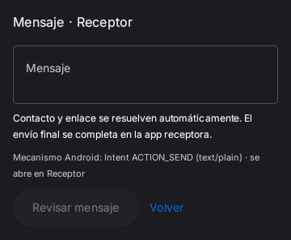
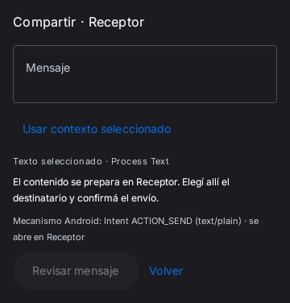
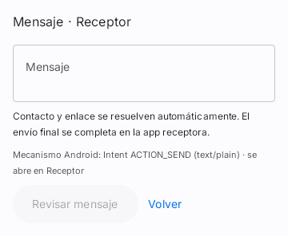
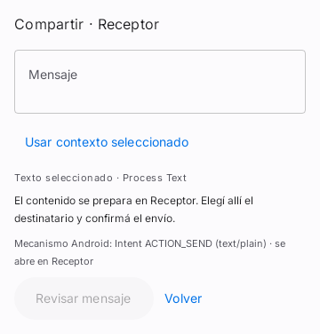
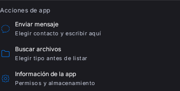
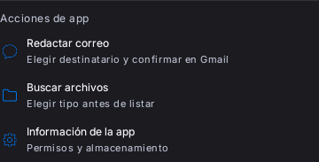
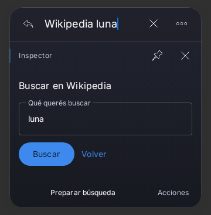
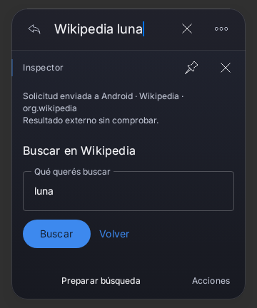
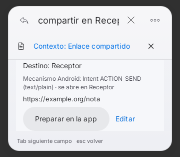

# C2 — capacidades, consulta y contenido compartido

[Informe funcional y límites](../../C2-CONTINUATION-20261104.md).
Base f49281a/PR21, posterior a la entrega Preview62. Estas funciones necesitan
una próxima APK autorizada; no se cambió la APK62 ni se ejecutaron Actions.

## Comparativas de componentes reales

Compose/Robolectric API33 NATIVE; misma escena por par, ancho360dp,
qualifiers w390dp-h844dp, escala/densidad de fixture predeterminadas (1),
texto y selección iguales. Componentes de producción compilados para pruebas
unitarias RaycastPreview; no dispositivo ni APK instalada. Sin retoque de PNG.
El formulario se captura con su altura natural dentro del mismo ancho/viewport:
la altura del recorte cambia al añadir controles, no demuestra altura del overlay.

| Cambio acotado | Antes | Después |
|---|---|---|
| Compartir texto: incorporación explícita y fuente, oscuro |  |  |
| Mismo formulario, claro |  |  |
| Gmail conserva destino; sin cliente de correo implícito |  |  |
| Solicitud Android diferenciada de efecto externo, Obsidian Glass |  |  |

Los tres pares de componentes usan el mismo fixture con Surface nativa:
fuente anterior8645d4c y producción actual567cc84. Se verificó el SHA256 del
fixture idéntico en ambos checkouts, cada uno con3 capturas correctas; el anterior
se compiló en worktree propio detached, sin alterar la rama ni otros worktrees.
[Procedencia y hashes de PNG](visual-provenance.json). Las primeras imágenes
before/after se conservan como historial: carecían de fondo Surface y el recorte
claro no permite juzgar contraste. No se sustituyeron baselines ni retocaron PNG.
El par de aviso usa el overlay real del fixture: c071455→567cc84. Los archivos de
producción actuales coinciden con production-hashes.json; capturas/semántica no
promueven aceptación física.
Wikipedia, Gmail y Receptor son actividades sintéticas de PackageManager, sin
cuentas conectadas ni transmisión real a esos proveedores.

## Confirmación alcanzable con poco espacio

Viewport320dp simula presupuesto corto, no Gboard real. La prueba desplaza hasta
Destino/Preparar en la app, mantiene footer dentro del contenedor, confirma una
vez y revalida el componente exacto. También alcanza el aviso posterior por
scroll, recupera700dp y comprueba que repetir no duplica la solicitud.
La escena usa el tema de sistema claro del fixture; no es una comparación del
hardware de Samsung con el teléfono. La física IME/OneUI sigue pendiente.

## Evidencia y fallos conservados

- web-red/web-green: descubrimiento WEB_SEARCH y contratos del ejecutor.
- query-red/query-green: consulta explícita, exactitud, homónimos y3 sugerencias.
- before/share-red: ausencia original de contexto/confirmación/destino Gmail.
- share-first:21/22 correctos y reproducción de pérdida de foco al cancelar.
- focus-first: primer parche en back no alcanzaba dismissInspector; se retiró.
- focus-green:4 correctos, foco y restauración sin autorización recuperada.
- receipt-red: solicitud aceptada sin aviso visible antes de la mejora.
- gate-first: revisión dirigida final; se conservan todos los XML, incluso fallos
  del fixture que comparaba frases parciales como texto completo.
- surface-before/surface-after:3 capturas equivalentes por fuente; sin repetir pruebas funcionales.
- final: repetir únicamente los casos afectados del fixture y ejecutar Lint.
  coverage.json identifica la última evidencia por caso, sin sumar repeticiones.

Los errores de compilación de fixtures (opt-in/import de StateRestorationTester)
y el primer No tests found también se conservan. Ninguno se cuenta como una
reproducción funcional o un caso aprobado. No se deshabilitan pruebas ni se
relajan permisos/guardas, aserciones de efectos, timeouts o contratos existentes.

Comando de verificación: :app:testRaycastPreviewUnitTest con
scripts/directed-tests.init.gradle y spotlightDirectedClasses/filtros de métodos;
:app:lintRaycastPreview. JDK17.0.21/SDK35/Gradle8.10.2, offline, un worker,
Gradle2GiB/SerialGC/Kotlin in-process, test1.5GiB. Sin assemble, R8, APK, firma,
Actions, red por pulsación o proveedor externo. No suite global ni medición p95,
jank, RAM o teclado físico. Capturas/semántica no demuestran efectos externos.

## Resultado y alcance

112 casos distintos de última evidencia correcta en coverage.json, incluyendo
capturas; no112 pruebas nuevas ni una suite global. El gate final95 se completó
por93 casos correctos +2 correcciones de fixture repetidas solas. Lint0errores,
26advertencias y1información; no se actualizaron dependencias ni suprimieron avisos.
La captura de la fuente anterior se excluye de la cobertura de regresión actual.
La aceptación física62 y los criterios de cierre C2 siguen abiertos.
