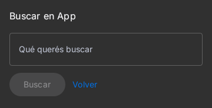
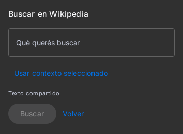
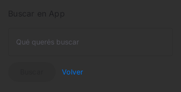
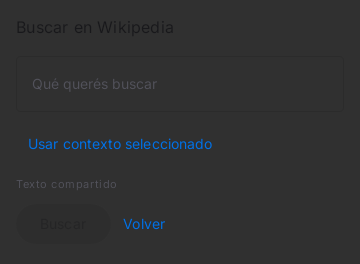
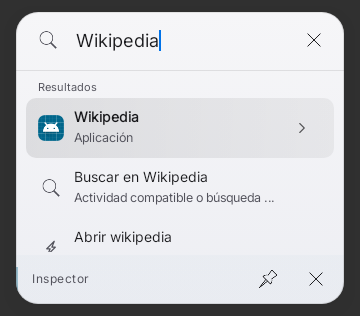
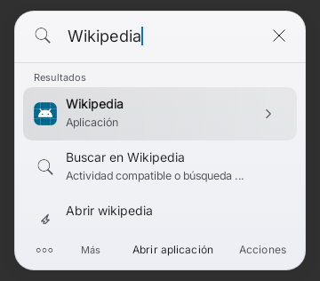
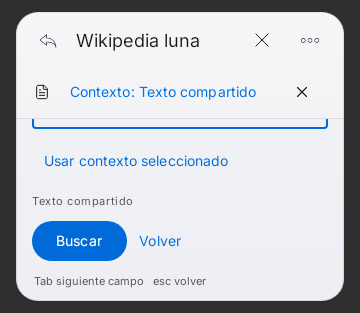
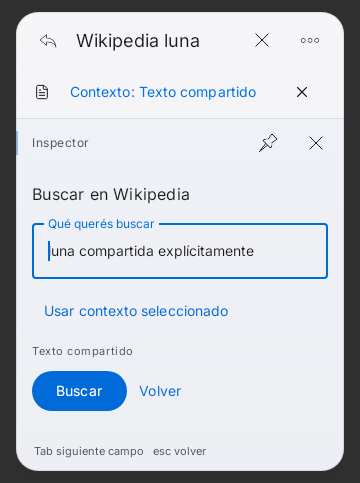

# C2 incremental — búsqueda pública por app y revisión explícita

Actualización final: F14/V05/V06 implementados;83 casos C2 distintos con última
evidencia correcta y Lint0errores/26advertencias/1información. Combinados con la
corrección de ventana:119 casos distintos, no una suite única.
[Informe de cierre](../../C2-IMPLEMENTATION-20261104.md).

Parte1 implementada después de la corrección independiente de ventana be14f7e.
Se reutilizan SearchEngine, ResultRanker, CompactResults, AppCapabilities,
IntegrationRegistry, formularios e inspector de C1 y NativeLaunchSession.
No hay otro motor, registro global, permisos, dependencias, WebView o APK nuevos.

## F01/F07/V02 — primer recorrido completo

- Consulta explícita «nombre de app + términos»: si el nombre coincide por palabras
  y hay una capacidad pública ACTION_SEARCH accesible, se prepara una búsqueda
  editable. Se conserva el texto/acento de los términos. El nombre más largo
  gana; paquetes/perfiles homónimos requieren seleccionar la app, nunca se elige
  uno por azar. Las integraciones documentadas que ya tienen proveedor no se duplican.
- La app exacta queda antes de una acción de idéntico nombre incluso con puntuación
  extrema. Se corrigen tanto ranker como presentación compacta; comando exacto
  frente a prefijo de app conserva su contrato anterior. Inicio mantiene tres
  sugerencias y no hay IA/remoto por pulsación.
- Catálogo de inspector: búsqueda deshabilitada y motivo visible si Android no
  publica la capacidad; revalidación al seleccionar. Una página principal VIEW
  de Sofascore ya no se presenta como prueba de búsqueda documentada.
- Antes de abrir un formulario genérico se revalida la actividad; al pulsar Buscar,
  NativeLaunchSession revalida/pinea destino y conserva la barrera de intento único.
  No fallback automático, envío, cuenta, lectura privada ni éxito externo ficticio.

La prueba UI recorre consulta→Enter→inspector/formulario→Buscar→Intent Android
exacto (paquete, componente y QUERY) y bloquea una segunda solicitud. Otra recorre
app exacta→inspector→capacidad pública→formulario→solicitud→Escape→consulta con
foco restaurado. App retirada entre búsqueda y selección no abre el formulario.
Las actividades son fixtures sintéticas, incluso cuando usan un paquete conocido:
esto acredita la solicitud Android en Robolectric, no Wikipedia instalada ni un
resultado de red o efecto físico verificado.

## Evidencia y correcciones de integración

65 casos distintos con última evidencia correcta en coverage-first.json; rondas
first-round, visible-round y request-round, no una suite única de65. Incluye
AppCapabilities9, NativeLaunchSession16, AppActionsSection3, SmartSearch13,
CompactResults13, C2ContextSearch5 y C2PublicSearchFlow6.

Antes de producción,3 fallos nuevos probaron ausencia de la ruta, empate exacto
incorrecto y búsqueda no disponible habilitada. La primera integración generaba
el resultado pero CompactResults aún lo excluía: el test UI lo detectó y se
corrigió la elegibilidad, sin quitar el filtro ni debilitar la prueba. Después,
un fixture esperaba cerrar Spotlight al solicitar la acción; keepSurface conserva
las tareas activas. Se corrigió la expectativa a conservar la tarea y se verifica
el Intent real y la ausencia de duplicado. XML anteriores conservados.

Dos capturas de referencia de formulario existente, claro/oscuro, teléfono360dp,
están en before/. Se reutilizan al unir contenido compartido en la siguiente
parte, manteniendo la composición nativa y sin nueva vista mayor.

Comandos: :app:testRaycastPreviewUnitTest con scripts/directed-tests.init.gradle,
spotlightDirectedClasses y filtros de clases/métodos de los XML. Un worker,
JDK17/SDK35/Gradle8.10.2, Gradle2GiB/SerialGC/in-process/test1.5GiB.
Sin suite global, Actions, assemble, firma, cuentas ni proveedor real. Lint y
parte F14/V05/V06 se registrarán en el siguiente checkpoint técnico.

## Pendiente y límites

Parte2 completada: texto autorizado de Share/Process Text→selección explícita en
formulario, footer con etiqueta de preparación y desplazamiento en viewport móvil
corto. No se transmite al seleccionar ni al copiar contexto; Buscar solicita la
acción Android. Los primeros4000 caracteres se anuncian si el texto es mayor.
La revisión identifica app y fuente, mantiene borradores y no añade envío real.

| Escena | Antes | Después |
|---|---|---|
| Formulario oscuro,360dp |  |  |
| Formulario claro,360dp |  |  |
| Inspector móvil, viewport320dp |  |  |
| Contexto compartido, viewport320dp | — |  |
| Contexto compartido, restaurado700dp | — |  |

Producción Compose API33 NATIVE, mismo fixture por par, temas claro/oscuro
existentes, paquetes/actividades sintéticos, sin dispositivo ni IME real. En el
inspector corto, antes el footer quedaba fuera de la ventana; después se alcanza
contenido mediante scroll. La captura de formulario corto está desplazada hasta
Buscar, con footer visible; desplazarse arriba permite revisar título/campo.

shared-red prueba ausencia del enlace de contexto. shared-round conserva la
primera ronda:19/20 correctos; el fallo era comparar EditableText vacío junto con
la etiqueta de TextField. Se comprueba el valor EditableText exacto, no se elimina
la aserción. compact-red reproduce footer fuera del viewport; se limita el cuerpo
existente, sin ocultar funciones. final tiene12/12 correctos (C2 UI10+C1 móvil2).
El caso nuevo de módulos falla antes en module-red; module-final tiene6/6 correctos
y Lint correcto. La ruta nueva reutiliza ExtensionStore y no cambia preferencias.
coverage-final.json identifica la última evidencia de cada caso; no se suman
repeticiones para inflar resultados. No hay tests deshabilitados ni baselines
cambiadas para ocultar fallos. Los nuevos avisos Lint son sólo GradleDependency.

No declarar C2 físico completo: OneUI/IME/rotación reales, accesibilidad y p95/
memoria requieren dispositivos y medición. C3–C9 y main siguen intactos.
