# Focus — acabado de producto / phone-dark
[Informe y límites](README.md)

Mismo lienzo: 360×700px. Mismo estado vivo, identidad y contrato; monogramas de fixture sintéticos. Abrir imagen para ver su tamaño original.

| Escena | Antes: presentación6d9289c | Acabado nuevo |
|---|---|---|
|Inicio compacto|[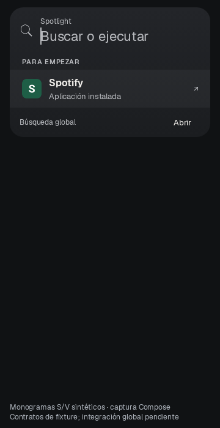](phone-dark-6d9289c-01-home.png)|[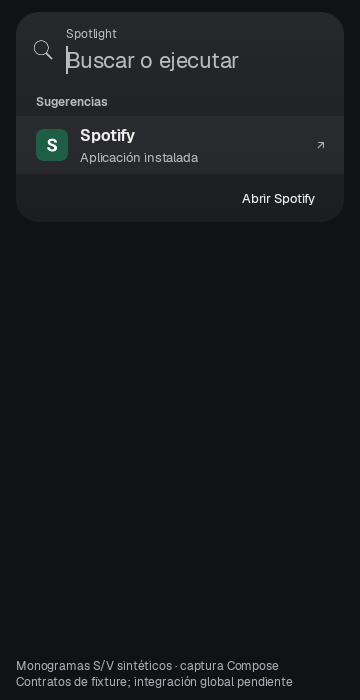](phone-dark-after-01-home.png)|
|Spotify global|[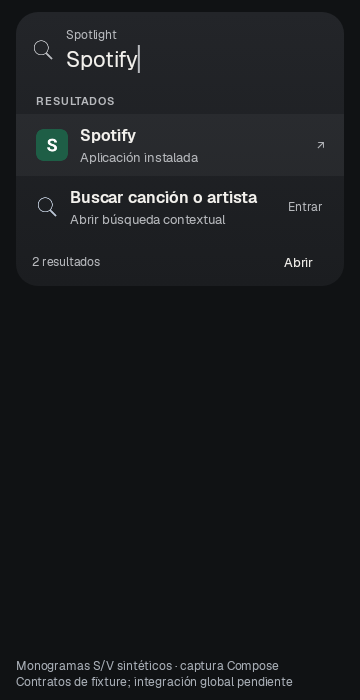](phone-dark-6d9289c-02-spotify-global.png)|[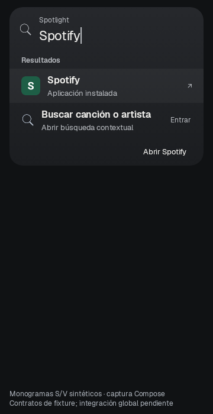](phone-dark-after-02-spotify-global.png)|
|Spotify contextual vacío|[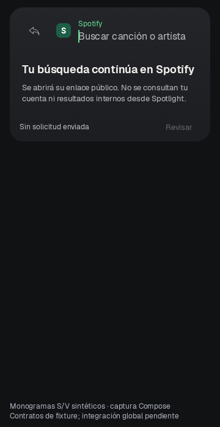](phone-dark-6d9289c-03-spotify-empty.png)|[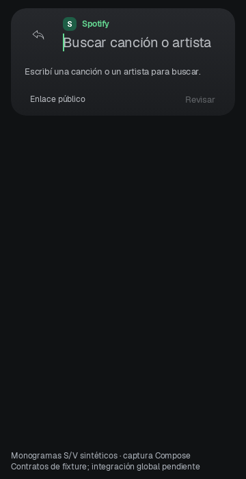](phone-dark-after-03-spotify-empty.png)|
|Spotify con texto y acción preparada|[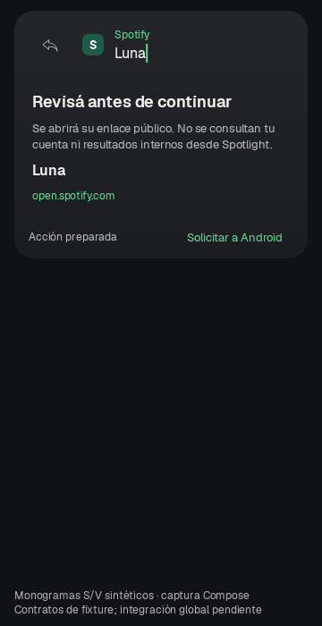](phone-dark-6d9289c-04-spotify-prepared.png)|[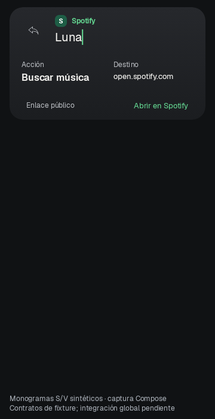](phone-dark-after-04-spotify-prepared.png)|
|Vivaldi global|[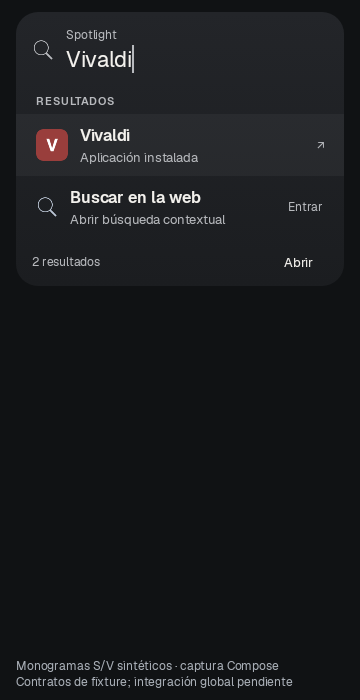](phone-dark-6d9289c-02-vivaldi-global.png)|[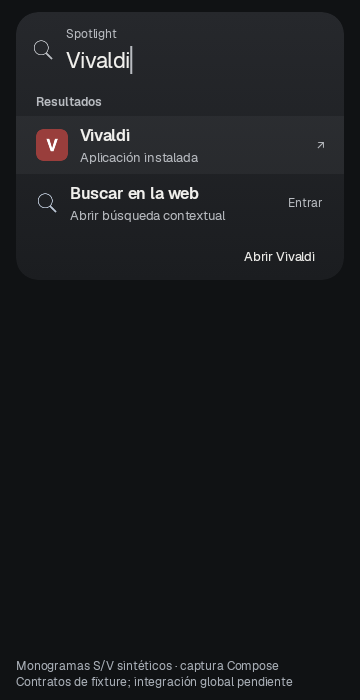](phone-dark-after-02-vivaldi-global.png)|
|Vivaldi contextual vacío|[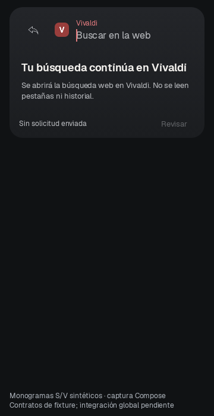](phone-dark-6d9289c-03-vivaldi-empty.png)|[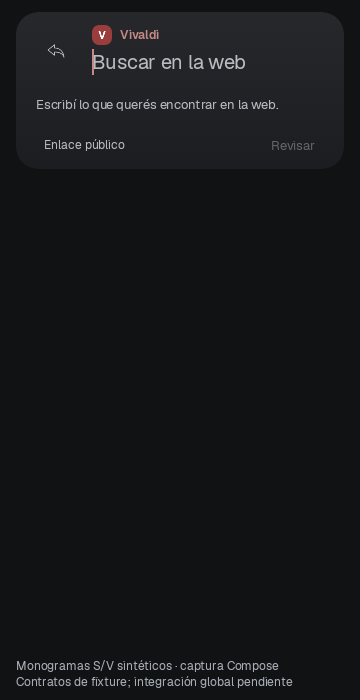](phone-dark-after-03-vivaldi-empty.png)|
|Vivaldi con texto y acción preparada|[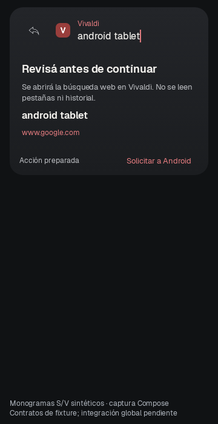](phone-dark-6d9289c-04-vivaldi-prepared.png)|[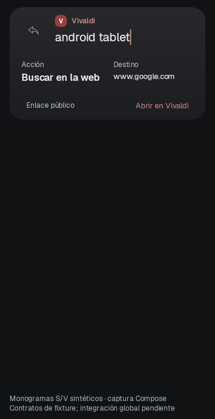](phone-dark-after-04-vivaldi-prepared.png)|

## Altura de la consola, incluidos márgenes (dp)

| Escena | Antes | Después |
|---|---:|---:|
|Inicio compacto|236.0|234.0|
|Spotify global|298.0|292.0|
|Spotify contextual vacío|244.0|181.0|
|Spotify con texto y acción preparada|301.0|212.0|
|Vivaldi global|298.0|292.0|
|Vivaldi contextual vacío|244.0|181.0|
|Vivaldi con texto y acción preparada|301.0|212.0|
