# Focus — phone-dark
[Informe y límites](README.md)

Mismo lienzo: 360×700 px. PNG originales; abrir cada imagen para verla completa. Pie de evidencia fuera de la consola.

| Escena | Referencia de estilo63 | Nueva revisión Focus |
|---|---|---|
| Inicio compacto | [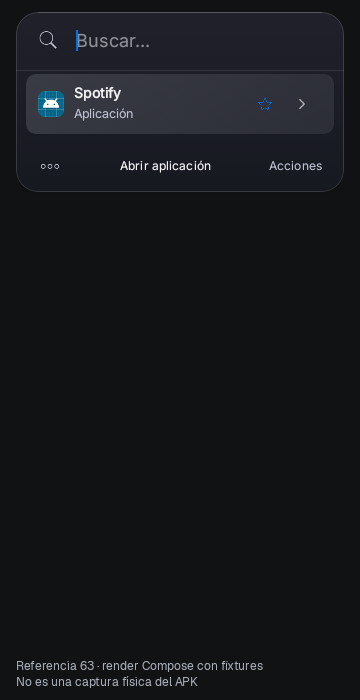](phone-dark-preview63-01-home.png) | [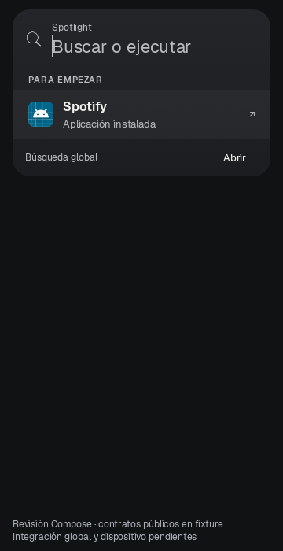](phone-dark-review-01-home.png) |
| Spotify global |  | [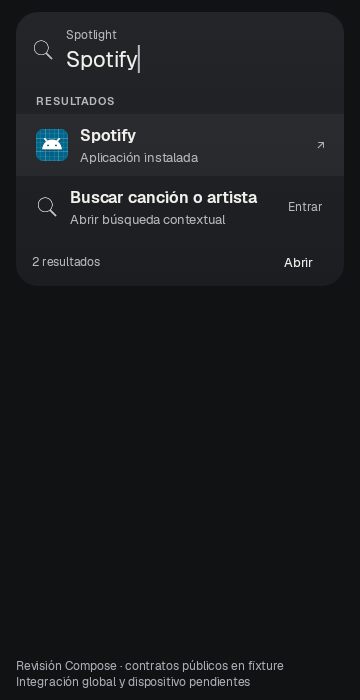](phone-dark-review-02-global-spotify.png) |
| Spotify contextual | [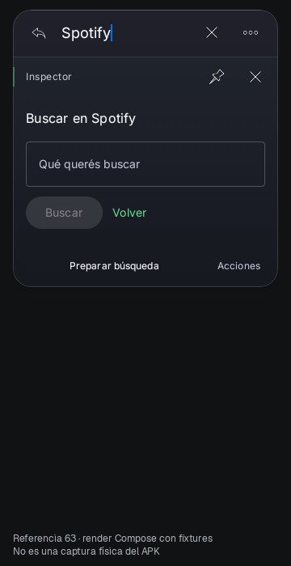](phone-dark-preview63-03-context-spotify.png) | [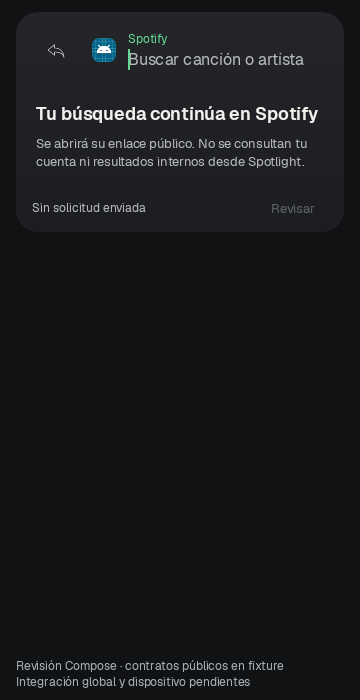](phone-dark-review-03-context-spotify.png) |
| Vivaldi global | [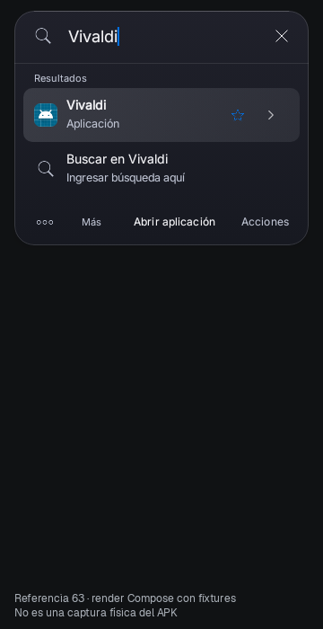](phone-dark-preview63-04-global-vivaldi.png) | [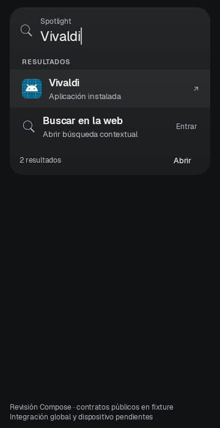](phone-dark-review-04-global-vivaldi.png) |
| Vivaldi web contextual | [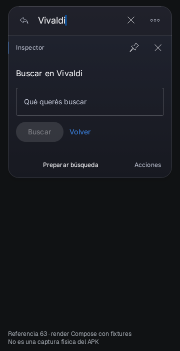](phone-dark-preview63-05-context-vivaldi.png) | [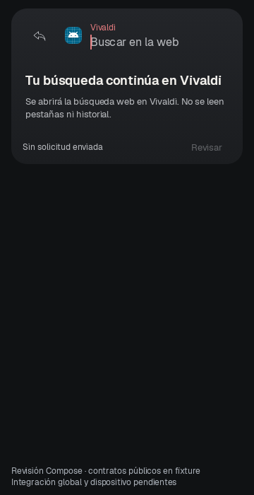](phone-dark-review-05-context-vivaldi.png) |
| Regreso a resultados | [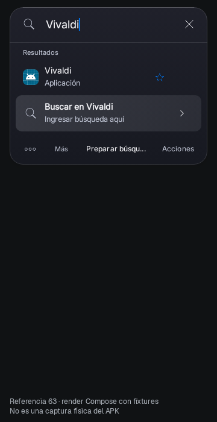](phone-dark-preview63-06-return.png) | [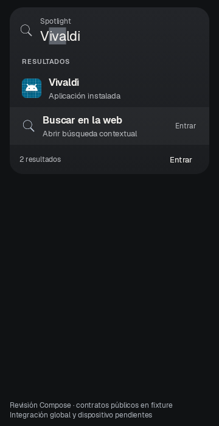](phone-dark-review-06-return.png) |

## B771 anterior: única escena soportada

Vivaldi con contexto seleccionado y consulta fija: no es un estado idéntico al nuevo contexto web. Inicio/Spotify y la transformación no estaban implementados en B.

[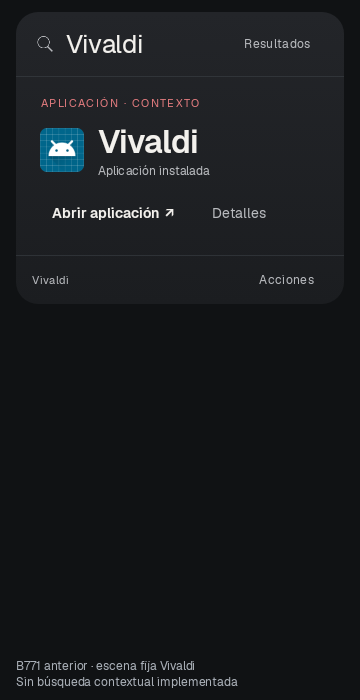](phone-dark-B-04-vivaldi-supported-context.png)

## Alturas con márgenes (dp)

| Escena |63|Focus|
|---|---:|---:|
|Inicio compacto|204.0|236.0|
|Spotify global|285.0|298.0|
|Spotify contextual|367.0|244.0|
|Vivaldi global|285.0|298.0|
|Vivaldi web contextual|367.0|244.0|
|Regreso a resultados|285.0|298.0|
