# Focus — tablet-light
[Informe y límites](README.md)

Mismo lienzo: 960×700 px. PNG originales; abrir cada imagen para verla completa. Pie de evidencia fuera de la consola.

| Escena | Referencia de estilo63 | Nueva revisión Focus |
|---|---|---|
| Inicio compacto | [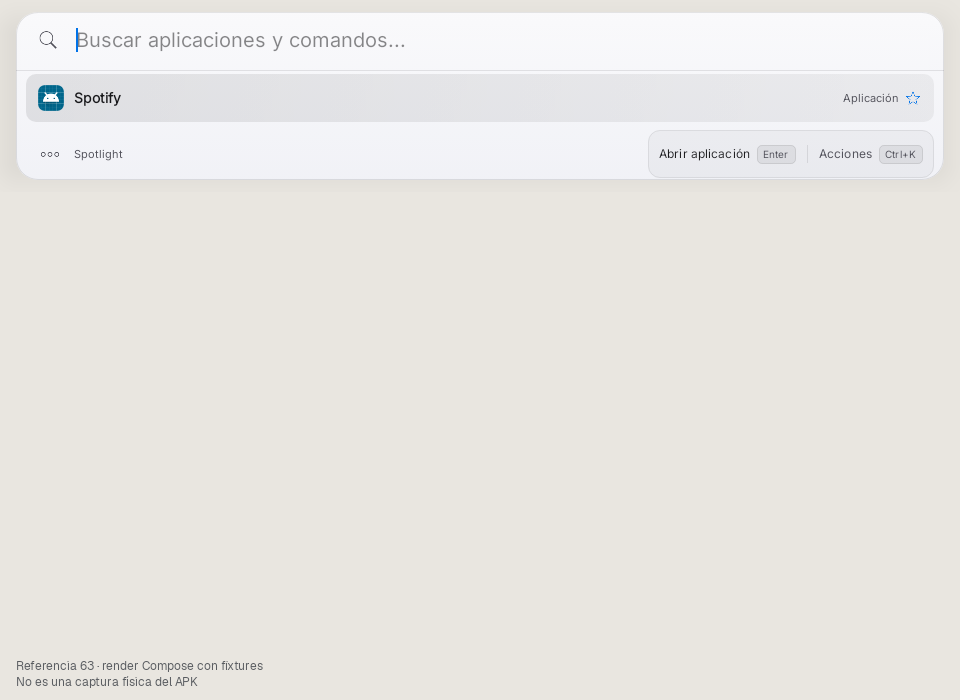](tablet-light-preview63-01-home.png) | [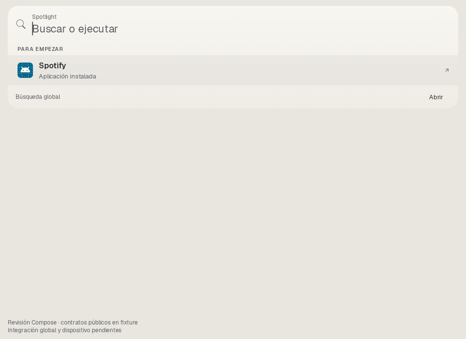](tablet-light-review-01-home.png) |
| Spotify global | [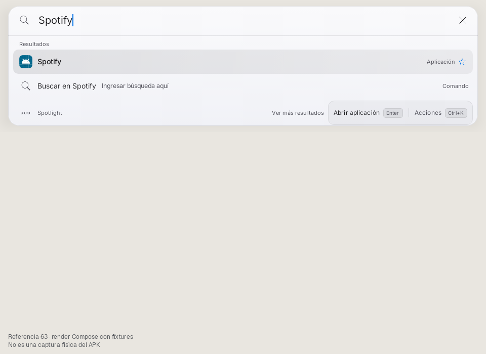](tablet-light-preview63-02-global-spotify.png) | [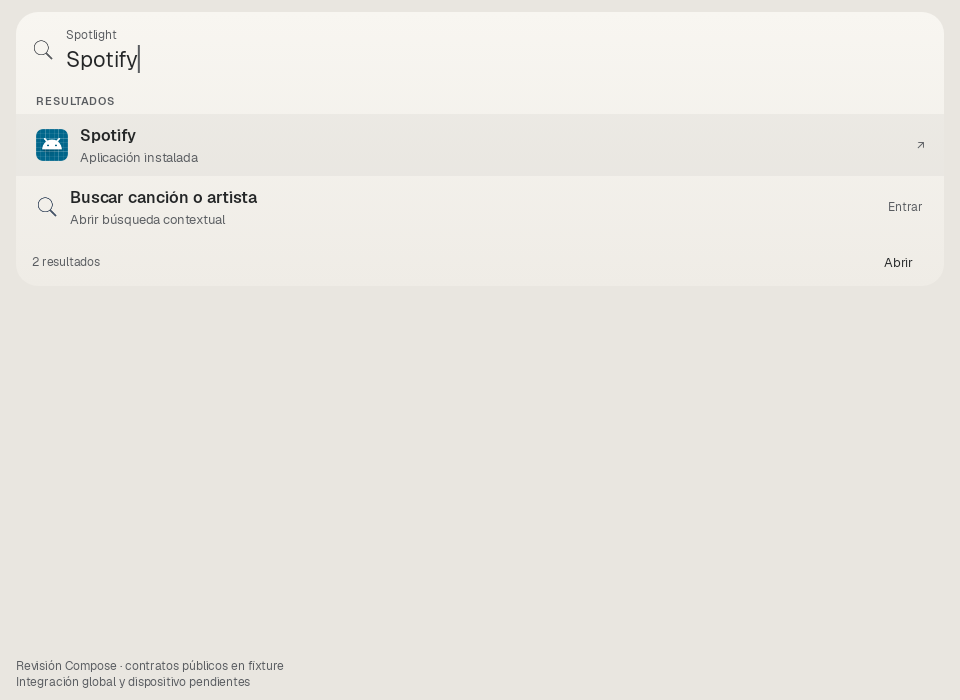](tablet-light-review-02-global-spotify.png) |
| Spotify contextual | [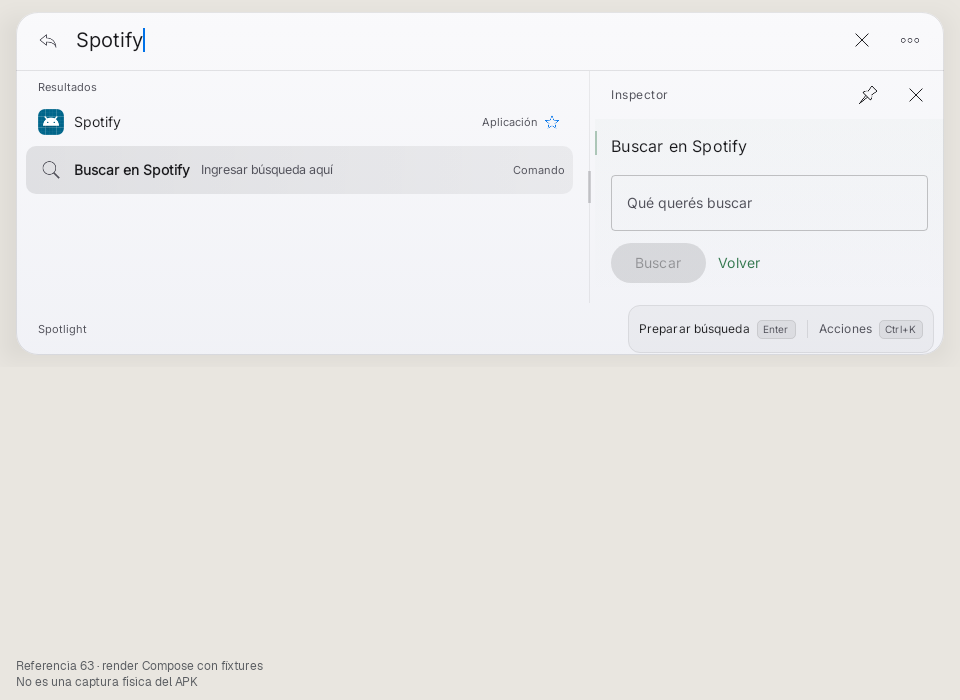](tablet-light-preview63-03-context-spotify.png) | [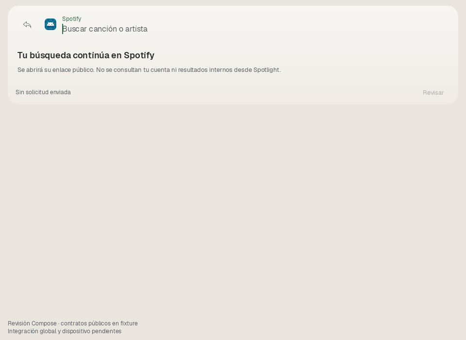](tablet-light-review-03-context-spotify.png) |
| Vivaldi global | [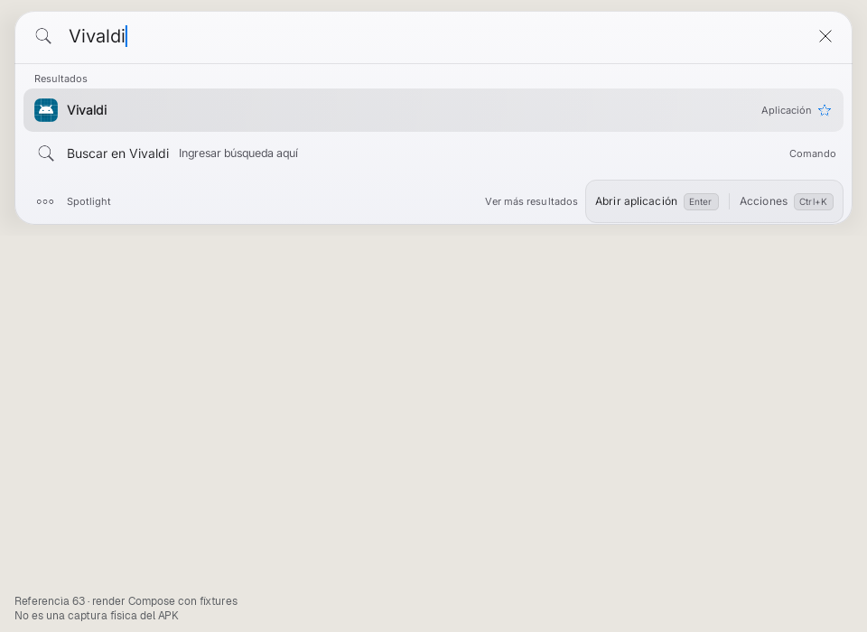](tablet-light-preview63-04-global-vivaldi.png) | [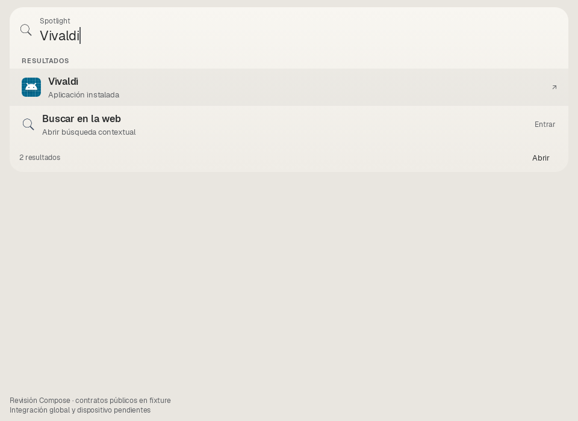](tablet-light-review-04-global-vivaldi.png) |
| Vivaldi web contextual | [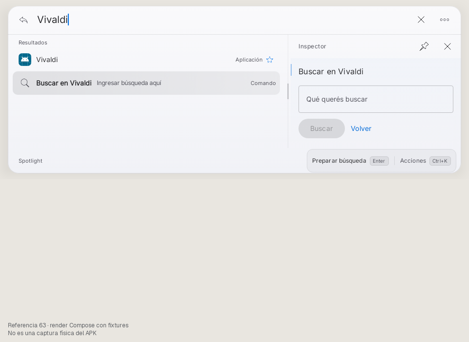](tablet-light-preview63-05-context-vivaldi.png) | [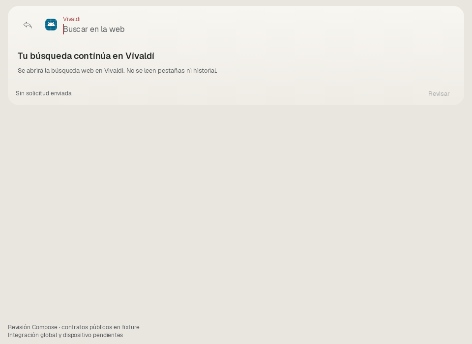](tablet-light-review-05-context-vivaldi.png) |
| Regreso a resultados | [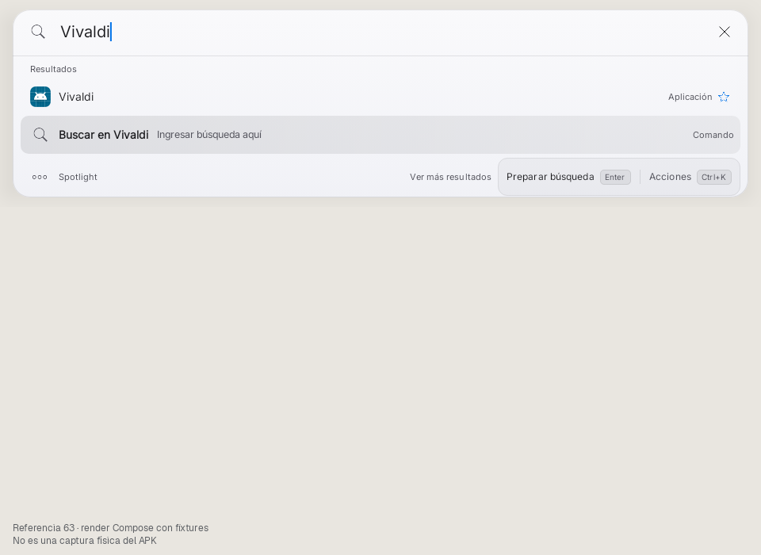](tablet-light-preview63-06-return.png) | [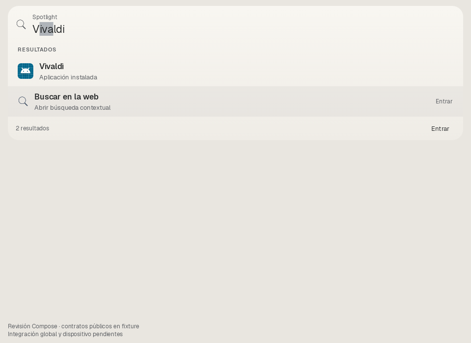](tablet-light-review-06-return.png) |

## B771 anterior: única escena soportada

Vivaldi con contexto seleccionado y consulta fija: no es un estado idéntico al nuevo contexto web. Inicio/Spotify y la transformación no estaban implementados en B.

[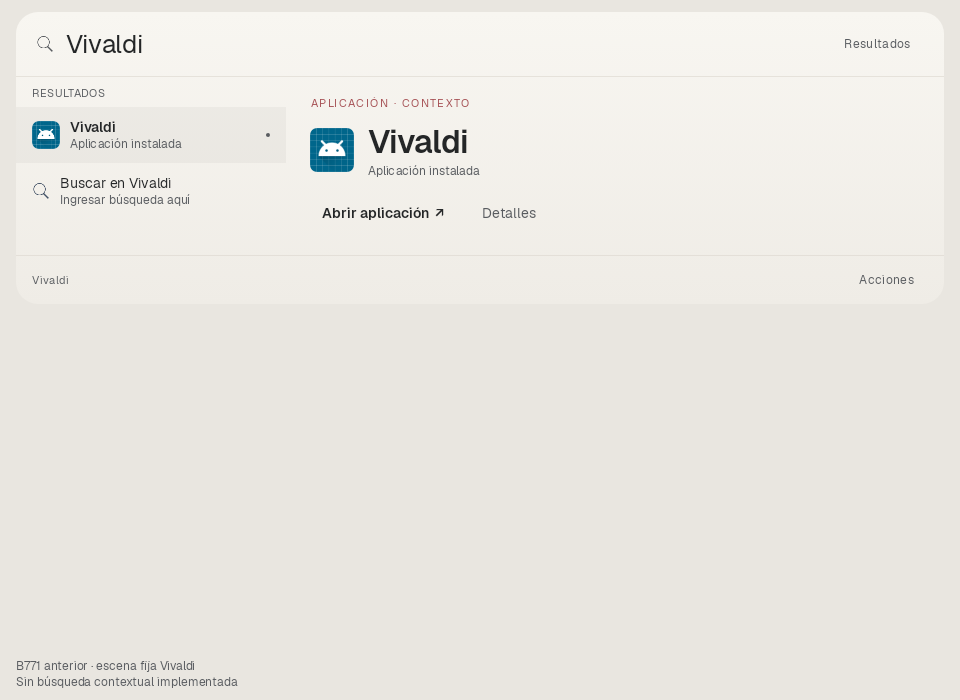](tablet-light-B-04-vivaldi-supported-context.png)

## Alturas con márgenes (dp)

| Escena |63|Focus|
|---|---:|---:|
|Inicio compacto|192.0|236.0|
|Spotify global|261.0|298.0|
|Spotify contextual|367.0|226.0|
|Vivaldi global|261.0|298.0|
|Vivaldi web contextual|367.0|226.0|
|Regreso a resultados|261.0|298.0|
