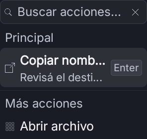
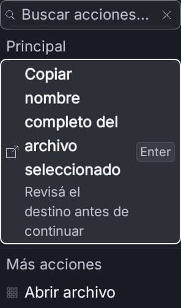
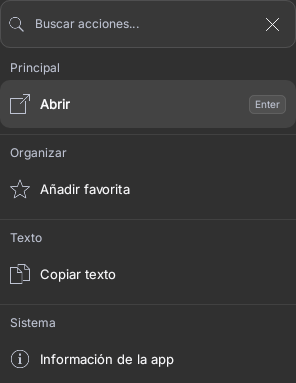
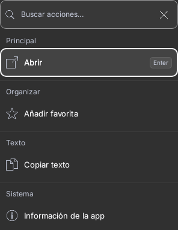
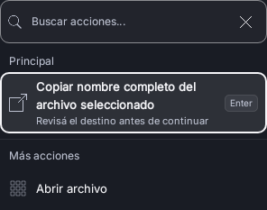
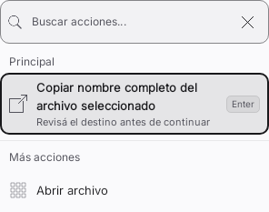
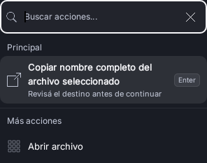
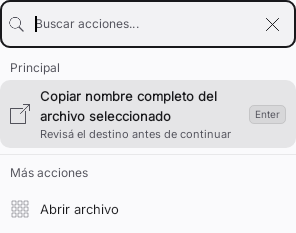

# Hallmark y Jakub sobre Preview 57

Continuación del PR #19, base `39f5c35ec56e50aa7d497995cff9d82869aebfd7`.
Aplicación acotada al menú contextual Compose, su filtro y sus acciones; no es
una certificación de toda la app. Sistema y estructura actuales conservados.

## Qué se aplicó realmente

| Skill de Jakub | Aplicación al componente |
| --- | --- |
| better-accessibility | Nombre accesible estable en el filtro, foco visible inmediato, estado vacío con live region polite y contratos de teclado comprobados |
| better-layout | Filas que crecen con su contenido, 320 dp, texto al 200% y disposición RTL |
| better-writing | Estado sin coincidencias que indica cómo continuar, con el voseo existente |
| better-typography | Título y detalle completos; interlíneas de 20/13 y 16/11 que escalan con el texto |
| better-colors | Roles `focusRing` e `inputOutline`; contraste medido desde píxeles de capturas en claro y oscuro |
| better-ui | Contorno de foco dibujado sin cambiar medidas del control, identidad de iconos y movimiento existente conservados |

Las otras ocho skills instaladas no se ejecutaron: generan variantes, estados
web, implementaciones desde Figma, ilustraciones o revisiones con otros contratos.
No se atribuye su ejecución a esta entrega.

De **Hallmark 2.0.0** se aplicó el modo de pulido compatible con app screens:
foco inmediato, contraste de controles, tokens por función, densidad y estructura
propias del producto. Material real: componente Compose y fixtures locales.
Audiencia: propietario que usa teclado y toque; acción principal: encontrar y
ejecutar una acción contextual. Carácter: preciso, discreto, operativo. No se
trasladan a Android reglas de landing pages, CSS, navegación web o temas sorteados.

El ejecutable `sloplint` se intentó con el componente y rechazó el formato Kotlin
(código 2); `sloplint-unsupported.log` conserva el resultado. No se presenta como
un sweep web aprobado. Se cumple el propósito de los criterios aplicables con
pruebas nativas, capturas y medición; la adaptación queda registrada en
`.hallmark/preflight.json` y `.hallmark/log.json`. Revisión final realizada en
este hilo, sin agentes adicionales ni revisores ficticios.

## Hallazgos y cambios

| Prioridad | Ubicación | Antes | Después | Criterio |
| --- | --- | --- | --- | --- |
| Alta | ActionPanelView.kt, filtro | El placeholder desaparecía al escribir y no había nombre accesible estable | Nombre semántico estable, también contextual cuando hay resultado | better-accessibility, nombre/rol; WCAG 4.1.2 como referencia |
| Alta | ActionPanelView.kt, fila y filtro | Sin contorno específico de foco; la selección no distinguía el foco del campo | Contorno de 2 dp asociado al foco real de cada elemento | better-accessibility y Hallmark 26a/15; WCAG 2.4.7 como referencia |
| Alta | ActionPanelView.kt, título y detalle | Ellipsis de una línea, reproducida con texto al 200% | Texto completo y filas con altura mínima, sin recorte forzado | better-typography/layout; WCAG 1.4.4 como referencia |
| Media | GlassTokens.kt, inputOutline | Borde tenue sin rol propio | Rol de borde y contraste medido mayor que 3:1 en los fixtures | better-colors y Hallmark 40/48 |
| Baja | ActionPanelView.kt, vacío | «No hay acciones con ese nombre.» | «No se encontraron acciones. Probá otro término.» | better-writing, recuperación explícita |

El estado sin coincidencias expone `LiveRegionMode.Polite`: las pruebas verifican
esa propiedad en el árbol semántico; la locución real de TalkBack no se afirma.
No se cambian identidades, ejecutores, selección, orden ni atajos de acciones.
El filtro conserva sus handlers. Los contornos de Compose se dibujan dentro
de los mismos límites; no añaden padding ni desplazan el texto al ganar foco.

## Comparativa real del componente

| Escena equivalente | Antes | Después |
| --- | --- | --- |
| 320 dp, texto 200%, Obsidian |  |  |
| Menú Raycast habitual |  |  |

| Foco nativo | Oscuro | Claro |
| --- | --- | --- |
| Acción |  |  |
| Filtro |  |  |

La primera prueba falla sobre la base por `TextLayoutResult.hasVisualOverflow`;
la captura se guarda antes de esa aserción. Tras el cambio pasan los cuatro
casos nuevos y los siete contratos existentes del menú: once casos únicos,
sin fallos, errores ni omitidos. Se preservan capturas, XML y logs del fallo y
del resultado correcto. El error de compilación inicial del fixture (icono que
no existe en el catálogo del proyecto) también queda conservado y se corrigió
usando un icono existente, sin cambiar producción para satisfacer la prueba.

## Contraste medido

`contrast.json` contiene colores RGB tomados de superficies planas renderizadas
y cálculo WCAG 2 de luminancia relativa. En los fixtures Obsidian claro/oscuro:

- Foco contra campo, superficie y fila seleccionada: mínimo **12.141:1**.
- Borde del campo contra interior y superficie: mínimo **3.291:1**.
- Umbral de referencia para estos elementos no textuales: **3:1**.

Las medidas cubren estos estados y fondos; no certifican todas las preferencias
de transparencia, colores de acento, temas ni fondos de otras apps. No se usa
el color de acento como anillo: algunos acentos no alcanzan 3:1 sobre la selección.
Los tokens nuevos toman sus valores de la paleta existente, sin introducir otra.

## Verificación y límites

JDK 17.0.21, Gradle 8.10.2, SDK/Build Tools 35; Robolectric API33 NATIVE.

```sh
bash gradlew :app:testDebugUnitTest \
  --tests dev.bautista.spotlight.ui.ActionPanelCraftTest \
  --tests dev.bautista.spotlight.ui.ActionPanelKeyboardContractTest \
  -I scripts/directed-tests.init.gradle \
  -PspotlightDirectedClasses=dev.bautista.spotlight.ui.ActionPanelCraftTest,dev.bautista.spotlight.ui.ActionPanelKeyboardContractTest
```

No se afirma una prueba con lector de pantalla físico, One UI, WindowManager,
IME ni rendimiento. La comprobación del nombre accesible se hace sobre el árbol
semántico de Compose. Tampoco se inventan estados de carga, error de proveedor o
éxito que este filtro local no implementa. No hay nueva APK firmada ni dependencias.

Veredicto: cambios del flujo inspeccionado aprobados por las comprobaciones
indicadas; cobertura integral de accesibilidad de la app **no verificada**.

Fuentes: [Jakub Krehel — skills](https://github.com/jakubkrehel/skills) y
[Hallmark](https://github.com/nutlope/hallmark). Sus reglas web se adaptan al
contrato nativo de Spotlight y no sustituyen `AGENTS.md`.

Lint RaycastPreview final: BUILD SUCCESSFUL en 2m, 0 errores, 26 advertencias y 1 información; log e informe XML conservados. No se desactiva ninguna regla.
