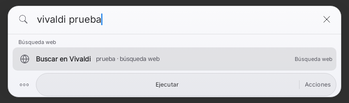
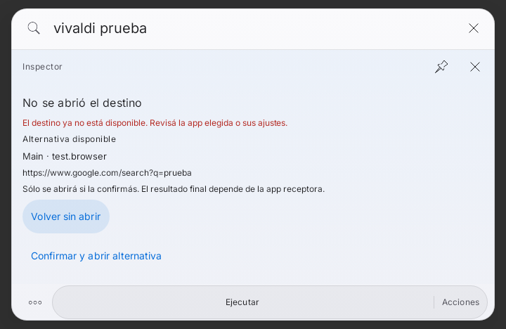
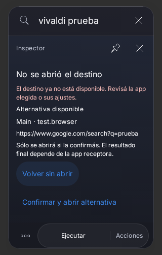

# Checkpoint2 — contratos nativos de lanzamiento Android

2026-11-03 UTC. Rama `feat/preview57-native-return-20261103`, PR21.
Padre: `f952cd4a10d98558b4ef69852e6a9e5031ac80d8`. El propietario autorizó
implementar el [plan del checkpoint2](../../CHECKPOINT-2-NATIVE-LAUNCH-CONTRACTS-20261103.md).
Se adquirió una reserva nueva al estar libre, después de verificar remoto/notas.

## Resultado funcional

Se retira el segundo lanzamiento automático de `SpotlightPanel.launch` y de
`Action.InApp`. Si falla el destino elegido, Spotlight conserva la consulta,
el contexto y los borradores; presenta una causa recuperable. Una alternativa
resoluble se muestra con app/paquete y destino, y sólo se solicita después de
confirmarla expresamente. El foco inicial es **Volver sin abrir**; Enter ahí
cancela. Tab puede enfocar Confirmar, y Enter o un toque explícito la solicitan.
Escape, Back, la X del inspector y Volver cancelan la propuesta sin cerrar todo.

`IntegrationRegistry` sigue siendo la autoridad de disponibilidad y permisos.
Su nueva validación de dispatch comprueba el componente y paquete vivos,
habilitación/suspensión, exportación, permiso de actividad y grants de URI de
lectura/escritura solicitados en data/ClipData/EXTRA_STREAM individual. Se fija
el componente recién validado antes de `startActivity`, evitando resolver otro
handler durante el lanzamiento. Al confirmar una alternativa se vuelve a
resolver y comprobar: un handler distinto exige nueva revisión.

`NativeLaunchSession` es una guarda de sesión alrededor de ese mismo ejecutor
Android, no un registro ni otro motor de acciones. Conserva snapshots acotados
de Intents nativos y un fence por contexto; no introduce scripts ni protocolo web.
Una propuesta tiene ID de un uso, componente esperado y hash del contenido
revisado. Se consume antes del efecto. Cambiar consulta, selección, payload,
contexto/formulario, fuentes/privacidad o cerrar/recrear la sesión invalida su
aprobación. Un Intent modificado después de preparar no cambia el snapshot;
modificar la propia propuesta la vuelve obsoleta.

Los fallos de entrada, disponibilidad y permiso se distinguen de resultado
incierto. Excepciones privadas no llegan a la UI. Una excepción de resultado
incierto no ofrece fallback ni reintento automático. La guarda rechaza repetidos
en el contexto vigente, con memoria acotada; una nueva selección/búsqueda permite
una nueva intención explícita. Cancelar una revisión de un fallo conocido sin
efecto también permite volver a seleccionarla. **No se promete exactly-once global
entre procesos ni que una app externa complete su efecto.**

La historia de lanzamientos de apps sólo se registra tras una solicitud aceptada,
no tras fallar. `REQUESTED` significa solicitud a Android, no entrega, reproducción
o tarea externa verificada. Shortcuts, MediaSession, SDKs, ToolExecutor y registros
existentes no se reemplazan. No se cambian fuentes de Spotify/WhatsApp, IA, RAGFlow,
OpenUI, documentos o WebView; el control es del lanzamiento genérico nativo.

## Pruebas: rojo antes y verde después

La reproducción inicial usa **SpotlightPanel real**, SearchEngine/ActionCatalog
reales y PackageManager de Robolectric. Un ContextWrapper de test hace fallar el
paquete elegido; la alternativa web sí está disponible. En `f952cd4`, la aserción
“no se abrió la alternativa sin confirmar” falla y Android de prueba registra el
Intent web. No es un test que copie la implementación antigua. `red/` conserva
XML, log y captura originales.

Dos regresiones adicionales se reprodujeron antes de corregirlas:
`close-grant-red/` conserva la X que dejaba viva la propuesta y el grant de
escritura revocado que no se comprobaba. La segunda corrida demoró9m28 por presión
de memoria, sin relajar aserciones ni aumentar timeouts; ambas fallan por su
contrato funcional, no por timeout. Se comprobó el límite8GiB y un daemon Gradle
anterior IDLE; al cerrarlo, el uso bajó aproximadamente a5.6GB y continuó el mismo
proceso de pruebas. No se detuvo el daemon BUSY ni se cambiaron fuentes históricas.

Los intentos de compilación de fixtures (`first-fixture/`) conservan el import
incorrecto de StateRestorationTester y el opt-in experimental faltante, corregidos
sólo en tests. `first-native/` conserva la primera ronda ampliada: dos problemas de
fixture (mutación del Intent registrado en PM y revocación URI no reflejada por
Robolectric), y el foco Material que no se conservaba en modo táctil. Se ajustaron
los fixtures manteniendo sus expectativas; la prueba de grants usa un Context
con respuesta de permiso controlada y la de snapshot muta extras sin alterar el
registro PM. La política real de foco permite enfocar explícitamente los botones
en touch/teclado, con solicitud tras frame. `focus-round/` conserva el seguimiento.
No se sustituyen fallos por verde ni se suman repeticiones como casos nuevos.

### Cohorte final

**52 casos únicos, cero fallos/errores/omisiones**, en una cohorte final:
NativeLaunchSession16, NativeLaunchFlow9, IntegrationRegistry2, AppCapabilities9,
ResultTouchScroll7, NativeCommandFlow5 y FloatingSearchFlow4. Pruebas+Lint:
**BUILD SUCCESSFUL en3m26s**, Lint **0 errores/16 advertencias/1 información**.
Los recuentos completos y logs están en `green/` y `summary.json`; no se suprimen
avisos ni se suman rondas repetidas.

- NativeLaunchSessionTest: disponibilidad, app retirada, actividad privada/disabled,
  permiso/URI revocados, excepción después de validar, resultado incierto,
  confirmación única, cancelación/dispose, contexto/handler/payload obsoletos,
  snapshot independiente y límite de tamaño.
- NativeLaunchFlowTest: reproducción original, confirmación por Tab/Enter y por
  toque, Enter en el botón seguro, Escape/X, consulta cambiada, restauración sin
  consentimiento y app instalada que continúa abriéndose sólo una vez.
- Regresiones dirigidas existentes: IntegrationRegistryTest, AppCapabilitiesTest,
  ResultTouchScrollTest, NativeCommandFlowTest y FloatingSearchFlowTest. Cubren
  descubrimiento, intents/grants, gestos sin activación, formularios/planes locales,
  consulta/inspector y navegación. No se modifican sus aserciones ni sus fuentes.

Fixtures de PackageManager, Context/servicio de permisos y proveedor de prueba:
no apps instaladas físicamente ni actividad real de browser fuera del laboratorio.
La ejecución de `startActivity` prueba la solicitud, no el resultado de otra app.

## Evidencia visual comparable

Mismo fixture de720dp, consulta, selección, tema claro aprobado y renderer antes
/después del mismo fallo. El callback de cierre del fixture registra la petición
pero no destruye el componente, permitiendo la captura anterior. No son mockups.
La geometría crece para mostrar la revisión contextual; no se oculta ese cambio.

| Antes: se solicitaba la web automáticamente | Después: revisión sin lanzar |
| --- | --- |
|  |  |

Obsidian Glass en teléfono320dp, después de la corrección (sin pareja antes):



Se utiliza el inspector y su tema existente, sin diálogo ni ventana añadidos.
La revisión tiene scroll acotado, textos completos, objetivos mínimos48dp y botón
seguro enfocable también en modo táctil. Fuente/paleta/iconos no se reemplazan.
`captures.json` conserva dimensiones/hashes y condiciones; capturas inspeccionadas
sin retoque ni cambio de baseline. Son Compose/Robolectric API33 NATIVE, no One UI.

## Alcance y límites

Sin nueva dependencia, permiso, persistencia/clave, framework, motor, servidor,
APK/assemble/R8/firma, cuenta, envío o Actions. Las variantes WebView y módulos
excluidos permanecen sin cambios. Main, PR19/20 y checkpoints se preservan; no se
promueve el puntero integral por pruebas dirigidas.

Pendiente: Web/Activity destino y permisos/grants/SAF reales en dispositivo,
One UI/IME/TalkBack/rotación y medidas de rendimiento. No se certifican efectos
Spotify/WhatsApp ni se conectó ninguna cuenta. La validación extra de grants se
limita a los URI que el Intent nativo expone; no es un deserializador de Intents
arbitrarios de terceros ni un motor de automatización.

## Comando final

```sh
JAVA_HOME=<JDK17> bash gradlew :app:testRaycastPreviewUnitTest --offline \
 --tests dev.bautista.spotlight.control.NativeLaunchSessionTest \
 --tests dev.bautista.spotlight.ui.NativeLaunchFlowTest \
 --tests dev.bautista.spotlight.control.IntegrationRegistryTest \
 --tests dev.bautista.spotlight.control.AppCapabilitiesTest \
 --tests dev.bautista.spotlight.ui.ResultTouchScrollTest \
 --tests dev.bautista.spotlight.ui.NativeCommandFlowTest \
 --tests dev.bautista.spotlight.ui.FloatingSearchFlowTest \
 :app:lintRaycastPreview -I scripts/directed-tests.init.gradle \
 -PspotlightDirectedClasses=dev.bautista.spotlight.control.NativeLaunchSessionTest,dev.bautista.spotlight.ui.NativeLaunchFlowTest,dev.bautista.spotlight.control.IntegrationRegistryTest,dev.bautista.spotlight.control.AppCapabilitiesTest,dev.bautista.spotlight.ui.ResultTouchScrollTest,dev.bautista.spotlight.ui.NativeCommandFlowTest,dev.bautista.spotlight.ui.FloatingSearchFlowTest
```

JDK17.0.21/SDK35/Gradle8.10.2 y dependencias cacheadas, sin nuevas descargas.
Sólo se compilan fuentes/recursos necesarios para tests y Lint; no se ensambla APK.
