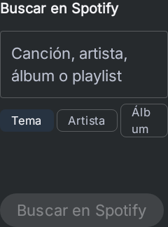
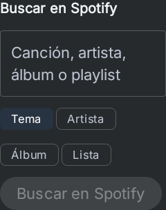

# Native visual iteration — 2026-10-25

Preview 51 remains delivered at source fe325812d32a83395c7882ff762f513526d9ae69: https://github.com/bauti3311-sys/Spotlight-Next/releases/tag/untagged-df0471cf57ce4d3a8cef . Its files/hashes remain unchanged.

## Visible correction
Four Spotify filters previously shared one Row. At 240dp with 150% text, Álbum wrapped and Lista was not displayed. The real production panel now uses FlowRow, preserving state, callbacks, tokens, touch controls and explicit playback confirmation. No new framework, colors, fonts, permissions or dependencies.

| Before | After |
| --- | --- |
|  |  |

Same fixture: API33, Robolectric NATIVE graphics, density1, fontScale1.5, portrait, 240dp component width, Graphite/Inter, empty query and Tema selected. Images240x324 and240x304; natural content height, no forced height. Before production: fe325812; test candidate e23e54c6. After product: e1080965; IME test-only correction6719bd55. Controlled public configuration/state, no real account/token, no HTTP or playback. These are compiled-component captures, not device or APK screenshots.

## Verified tests
28 unique UI cases passed across directed cohorts; repeats counted once. Three filter cases cover narrow/large-text geometry, tablet and actual Tab/Enter focus/selection without playback. Eight cases cover app action navigation, accessibility roles and overlay error/restoration. Sixteen cover adaptive results, footer/keyboard viewport, Compacta, inspector, Saved and action-panel close behavior. The corrected IME case additionally verifies current search/close header geometry, Volver footer, 48dp close target and native InputMethodManager hiding.

Failures retained:
- Original Row: one geometry failure2m25s, screenshot missing Lista.
- First corrected-product gate:10/11; keyboard fixture still in touch mode. One-method diagnostic preserved. Per official Android focus codelab, request and assert InputMode.Keyboard before real Tab/Enter; focus assertions retained and strengthened.
- Surfaces:16/17 in1m1s. IME test expected obsolete Acciones text; current footer says Volver and header is action-filter plus close. Parent-view capture confirms visible footer. Updated test asserts actual header/close bounds and footer and retains all native IME assertions;1/1 passed2m8s. No product keyboard/layout change was needed for this test.
- Final filter compile/lint gate9m8s:3/3, lint0errors14warnings.

QuickLookTouchTargetTest exercises action-panel closing, not PdfRenderer or physical PDF rendering. Physical One UI, real keyboard, TalkBack, jank and real Spotify/WhatsApp service behavior remain unvalidated. Matrix9/25/6 unchanged.

Skills adoption, source SHAs, licenses and exclusions: [.agents review](../../../.agents/skills/spotlight-raycast-native/references/adoption-review.md). No third-party installer/hooks or CI used.
