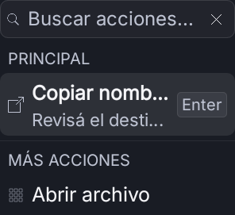
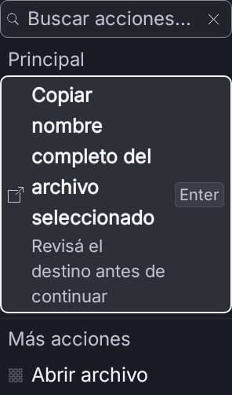
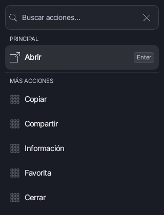
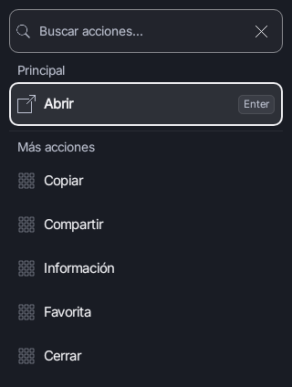
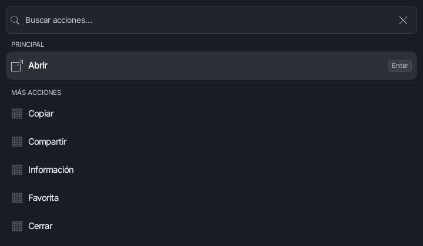
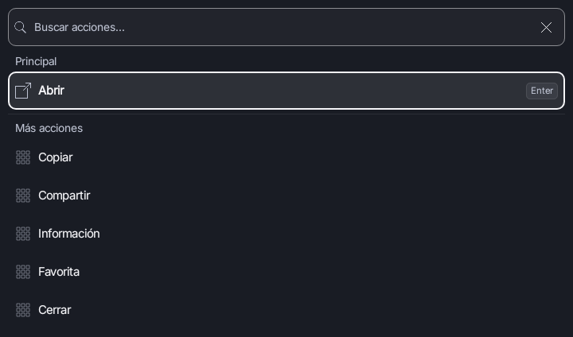
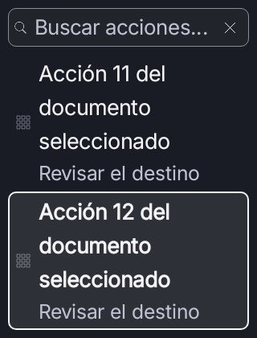

# Preview57 nativa — correcciones selectivas del PR19

2026-11-03 UTC. Rama `feat/preview57-native-return-20261103`, PR21.
Padre publicado: `1d582940bad2767b710d1e10e9ef93f78e8fb092` (auditoría).
Origen revisado: PR19, `a622df75208e40826955e51cc84c65d7754f9f53`.
Reserva adquirida normalmente al estar libre; main/checkpoints/otros worktrees
verificados antes de escribir. Se continúa sobre Preview57 Kotlin/Compose.

## Cambio acotado

Sólo tres archivos productivos, idénticos a sus versiones revisadas de PR19:

- `ActionPanelView`: títulos/detalles completos, grupos con escritura natural y
  semántica de encabezado, foco visible, nombre accesible del filtro contextual
  que permanece al escribir y vacío con indicación de recuperación/live region.
- `GlassTokens`: roles de borde/foco con los colores existentes y trazo2dp.
- `SpotlightBar`: Box en lugar de BoxWithConstraints sin restricciones usadas;
  mismo contenido y jerarquía, elimina el problema de Lint conocido.

`adoption.json` conserva hashes de los tres archivos y confirma la coincidencia
con PR19. No se cherry-pickean sus commits completos, documentación, herramientas,
Hallmark o skills adicionales. Sin cambios de ejecutores, resultados, iconos,
permisos, paleta/fuentes, preferencias, paquetes, versiones o dependencias. El
máximo560dp del menú, los paddings y objetivos mínimos48dp se conservan.

## Pruebas nativas ejecutadas ahora

Una cohorte final de **19 casos únicos**, cero fallos/errores/omisiones:

| Suite | Casos | Qué demuestra |
| --- | ---: | --- |
| ActionPanelCraftTest | 5 | Texto al200% sin overflow, RTL, foco y filtro claro/oscuro, recuperación vacía, Enter/Escape, nombre contextual estable al editar |
| ActionPanelScrollContractTest | 3 | Densidad compacta teléfono/tablet y scroll real con12 acciones, texto200%, escala115% y densidad85%; última acción completa y accesible |
| ActionPanelKeyboardContractTest | 7 | Identidad al reordenar/eliminar, submenú/Back/dispose, filtro/CtrlF/CtrlK, Tab/ShiftTab/flechas/Enter y encabezados semánticos/objetivos48dp |
| SpotlightBarTest | 4 | Opciones en la misma ventana, categorías/callbacks, texto/borrar y altura acotada para teclado |

La prueba de scroll verifica que el contenido realmente desborda, arrastra con
input táctil y comprueba aumento del desplazamiento sin callbacks. Luego recorre
las12 acciones con Tab, verifica foco y bounds de la última debajo del filtro y
dentro del menú, ShiftTab/flecha vuelven correctamente, Enter ejecuta sólo esa
acción una vez y Escape cierra sin ejecutarla otra vez. No sustituye el drag por
un cambio directo del estado de scroll. `performScrollTo` sólo vuelve al inicio
entre la fase táctil y la de teclado.

Con seis títulos cortos, ambos anchos320/720dp muestran todas las filas y cada
fila sigue midiendo **48dp**. El alto intrínseco del fixture cambia420→424px por los
dos encabezados legibles (4dp con densidad de prueba1); no cambia el ancho ni el
máximo del menú. Con texto200% la fila larga crece para mostrar todo, y se usa el
scroll existente; no se achica la fuente ni se vuelve a truncar para encajar.

Pruebas de callbacks sólo de laboratorio: no abren apps ni envían mensajes.
Robolectric API33 NATIVE para menú; SpotlightBarTest API28. No hay dispositivo
físico, validación One UI/IME/InputDispatcher/TalkBack real ni medida de rendimiento.

## Reproducción anterior y fixture corregido

Antes del cambio productivo se ejecutó el mismo caso `largeTextKeepsCompleteActionAndDescription`
sobre el código de `1d58294`: falló por overflow del título completo. XML y captura
originales en `before/`. No se sustituyó esa captura ni se actualizó una baseline
para ocultar el fallo.

En esa primera invocación también fallaron dos pruebas nuevas de densidad por
medir el testTag interior **después del padding**: esperaban320/720dp y obtenían
300/700dp. No era un defecto productivo. Se corrigió el fixture para medir el
contenedor exterior al padding, manteniendo ancho total y aserción exacta de48dp
por fila. Se repitieron únicamente esos dos casos sobre producción todavía sin
modificar:2/2 correctos, con capturas antes comparables. `initial-fixture/`
conserva todos los XML/logs iniciales; `before/density-build.log` conserva el
reintento dirigido. No se suman esas rondas a los19 casos finales.

## Comparativas reales del componente Compose

Mismo fixture, renderer, viewport, tema, escala, texto y selección antes/después.
Son capturas Robolectric, **no APK ni dispositivo**. No hay máscara ni imagen
retocada. La altura variable es parte del resultado que se evalúa.

| Escena | Antes | Después |
| --- | --- | --- |
| Teléfono, texto200%, título/detalle largos |  |  |
| Teléfono320dp, densidad85%/texto115% |  |  |
| Tablet720dp, densidad85%/texto115% |  |  |

Última acción tras desplazamiento/teclado, texto200%/escala115%, dentro de420dp
con filtro fijo; esta captura es **sólo después**, sin pretender una pareja A/B:



También se conservan capturas de foco de fila/filtro claro y oscuro en `after/`.
`captures.json` registra tamaños/hashes y condiciones. Las comparativas se
inspeccionaron: iconos, composición y colores conservados; foco y lectura mejoran
sin un rediseño. No se extrapola el contraste a todos los fondos o transparencias.

## Gate y reproducción

Gate final pruebas+Lint: **BUILD SUCCESSFUL en2m35s**. Lint RaycastPreview:
**0 errores,16 advertencias y1 información**, informe XML completo conservado;
no se afirma mejora de recuento frente a otro entorno/HEAD. Las advertencias no
se suprimen ni se añade baseline. El traspaso sólo actualiza selectores antiguos
de SpotlightBarTest al nombre actual «Opciones de Spotlight» y fortalece los
encabezados del menú; conserva callbacks/teclado/altura de las pruebas previas.

```sh
JAVA_HOME=<JDK17> bash gradlew :app:testRaycastPreviewUnitTest --offline \
  --tests dev.bautista.spotlight.ui.ActionPanelCraftTest \
  --tests dev.bautista.spotlight.ui.ActionPanelScrollContractTest \
  --tests dev.bautista.spotlight.ui.ActionPanelKeyboardContractTest \
  --tests dev.bautista.spotlight.ui.SpotlightBarTest \
  :app:lintRaycastPreview -I scripts/directed-tests.init.gradle \
  -PspotlightDirectedClasses=dev.bautista.spotlight.ui.ActionPanelCraftTest,dev.bautista.spotlight.ui.ActionPanelScrollContractTest,dev.bautista.spotlight.ui.ActionPanelKeyboardContractTest,dev.bautista.spotlight.ui.SpotlightBarTest
```

Entorno usado: JDK17.0.21, SDK/Build Tools35, Gradle8.10.2 y cachés existentes;
truststore del entorno configurado por argumento JVM. No dependencias nuevas.
La compilación de fuentes/recursos requerida por las pruebas no es assemble de
la APK: no se invoca assemble/package de producto, firma, R8 ni GitHub Actions.
Logs y XML se preservan sin alterar resultados originales.

## Continuidad

[Checkpoint2 preparado: contratos Android](../../CHECKPOINT-2-NATIVE-LAUNCH-CONTRACTS-20261103.md).
Especifica alcance, causa y casos de aceptación; **sin implementación todavía**.
OpenUI/RAGFlow no se implementan. Los controles de procedencia de la auditoría
anterior verificaban el árbol1d58294 sin cambios productivos: son evidencia
histórica, no un gate aplicable al menú modificado de este checkpoint.
Main, PR19/20, variantes WebView y checkpoints permanecen intactos. Se publica en
la rama de PR21, sin merge; cierre y liberación sólo de la reserva propia.
