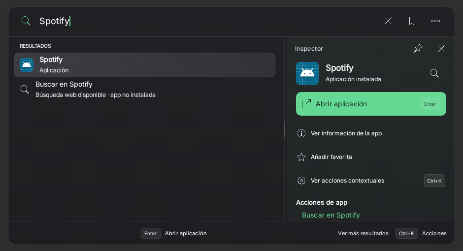
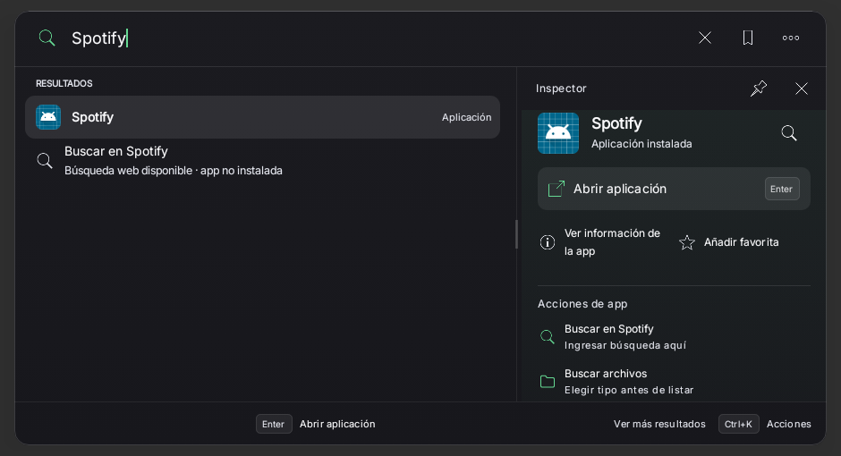

# Ventana nativa Raycast — 25/10/2026

Capturas completas del componente productivo SpotlightPanel, no mockups ni renders web. Mismo escenario: API33, Robolectric NATIVE, ancho940dp, presupuesto510dp, fuente1.0, consulta Spotify, Solid Graphite y preferencia guardada de opacidad70%. Iconos/paquetes controlados de pruebas (placeholder Android), sin cuenta Spotify ni validación física.

| Antes | Después |
|---|---|
|  |  |

Antes2104dbb:3 casos,2 fallos por encabezado del inspector fuera de pantalla tras scroll. b44c154:34 casos correctos,5m26s. Pulido787b476:11 casos repetidos correctos,4m36s; no sumar45 únicos. La prueba final exige Buscar en Spotify visible, Información única, ausencia de acceso duplicado a acciones y targets48dp. Ctrl+K/footer permanecen operativos.

Primer error de compilación9f6055f conservado: llamada antigua por posición; sobrecarga compatible restaurada. Sin dependencias, permisos, firma ni mecanismos de Spotify nuevos. Reproducción real y One UI pendientes.

Referencias de comportamiento: https://developers.raycast.com/api-reference/user-interface/list y https://developers.raycast.com/api-reference/user-interface/action-panel . Implementación Kotlin/Compose propia, sin copiar React/SDK de Raycast.
