# Vivaldi — A / Unified Command Surface y B / Spotlight Focus

Exploración estructural expresamente autorizada tras rechazo visual de dee1efd
(aprox.6,3/10). Ninguna opción adoptada. dee1efd permanece en el historial.
Todo el código nuevo de composición está en **app/src/test**, fuera del APK.
No se modifican componentes, motores, estado, permisos o contratos de producción.
C1/C2 y las pruebas funcionales existentes se conservan; main no se modifica.

## Comparación real Compose

12 PNG nativos Roborazzi/API33:4 referencias de estilo63 y8 vistas nuevas.
Mismo lienzo por perfil:tablet960×700px, teléfono360×700px, densidad mdpi del
laboratorio, margen horizontal16dp/vertical12dp y mismo fondo exterior.
No imágenes generadas, redibujadas, escaladas ni retocadas. En cada perfil:

| Perfil | Preview63 | A — Unified | B — Focus |
|---|---|---|---|
| Tablet oscuro | [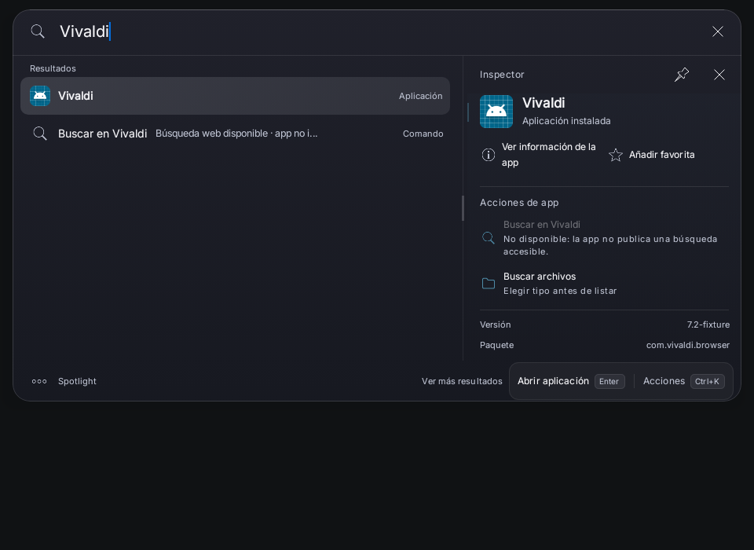](tablet-dark-preview63.png) | [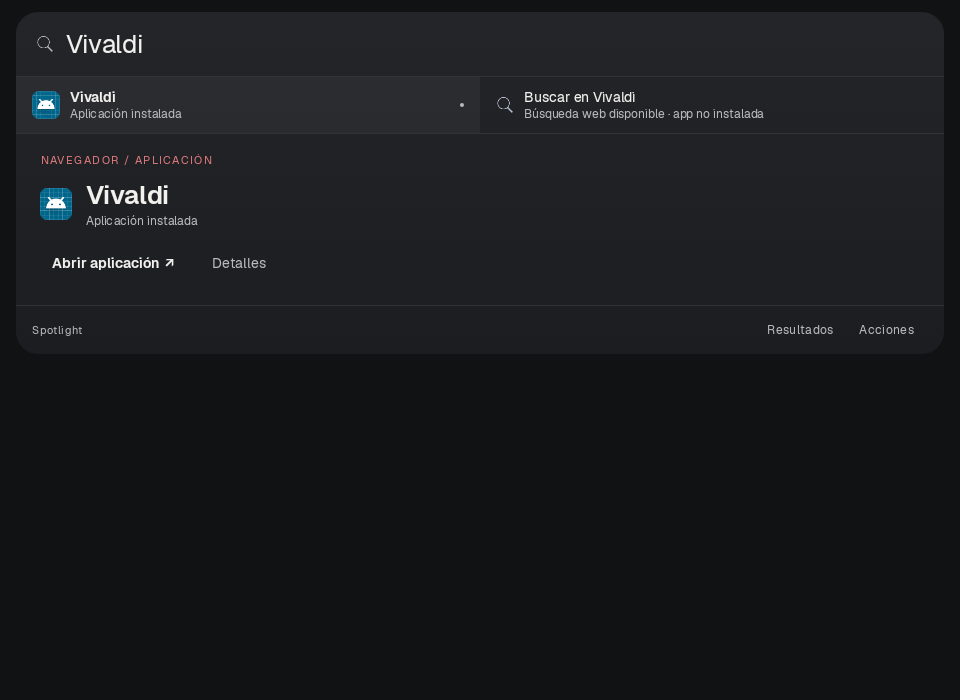](tablet-dark-A.png) | [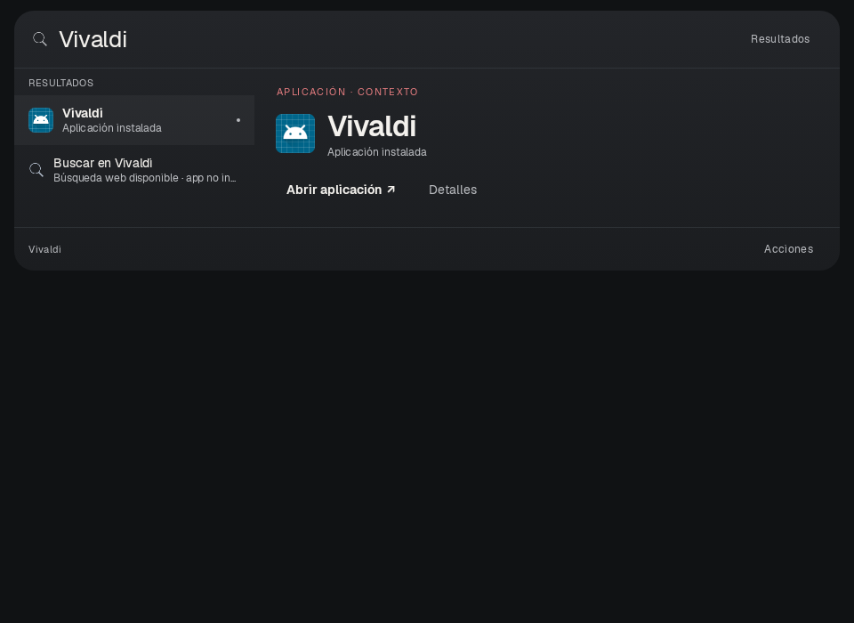](tablet-dark-B.png) |
| Tablet claro | [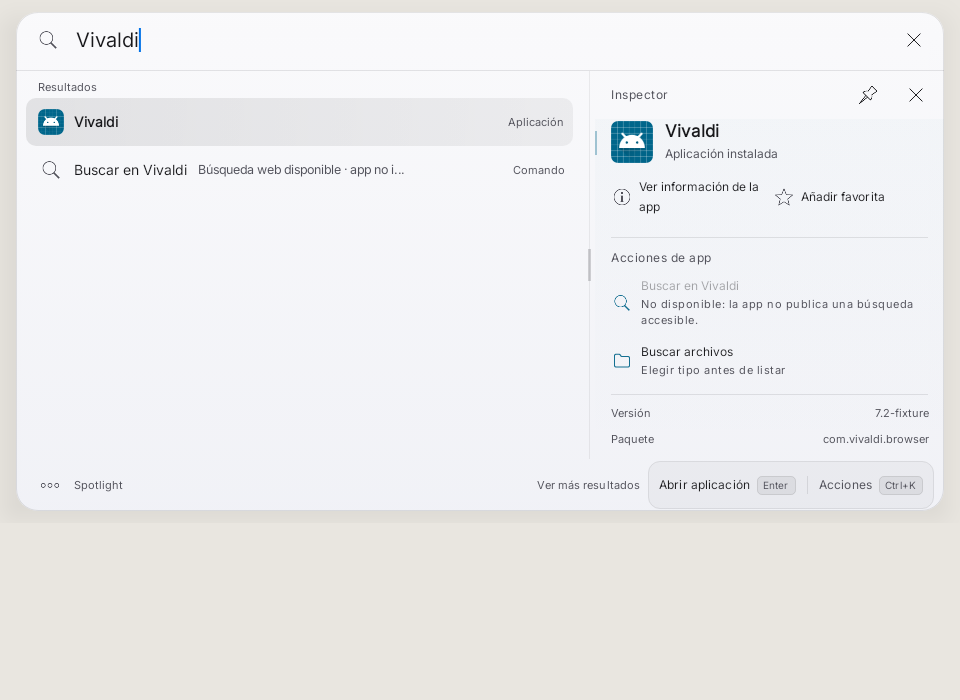](tablet-light-preview63.png) | [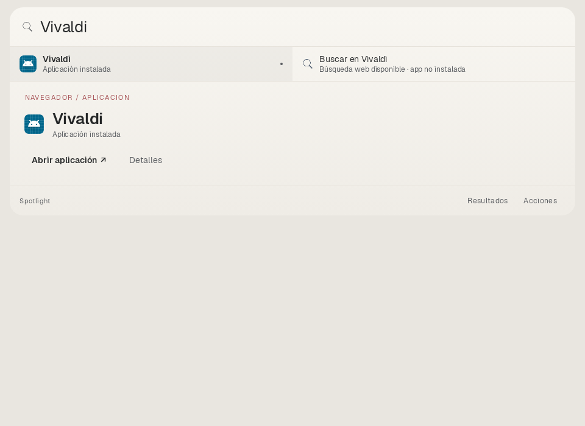](tablet-light-A.png) | [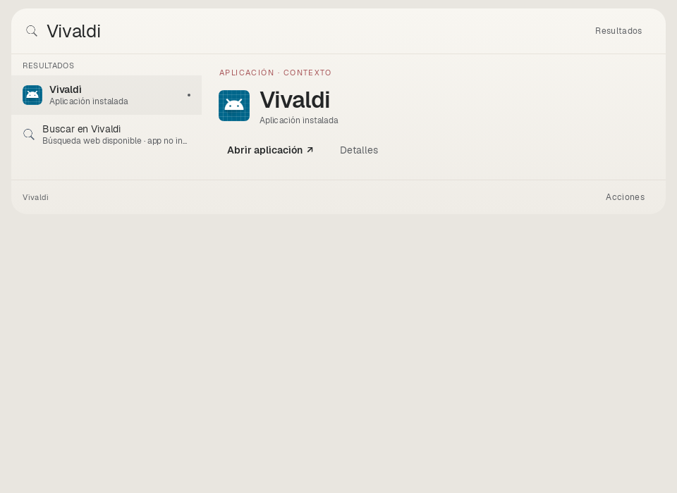](tablet-light-B.png) |
| Teléfono oscuro | [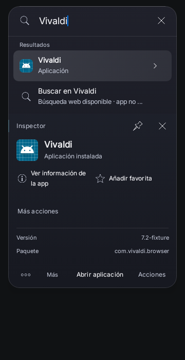](phone-dark-preview63.png) | [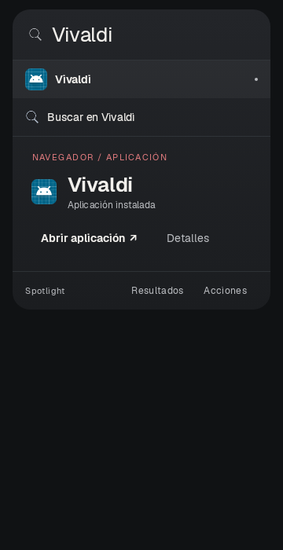](phone-dark-A.png) | [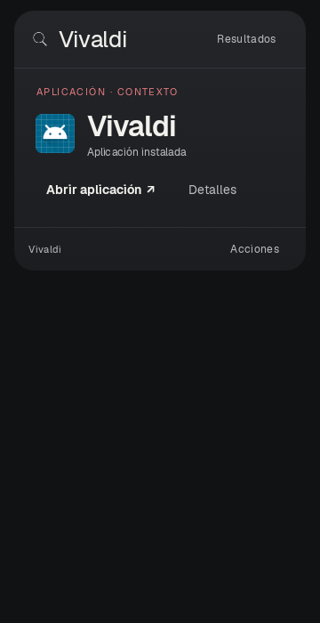](phone-dark-B.png) |
| Teléfono claro | [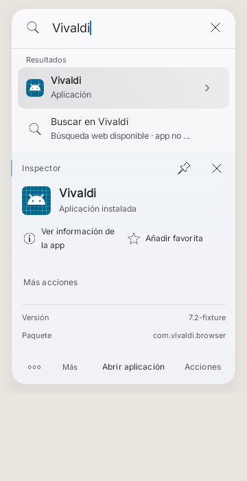](phone-light-preview63.png) | [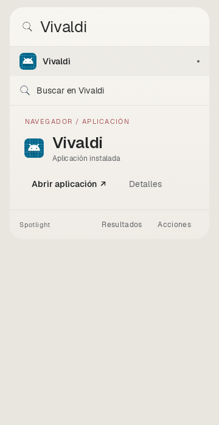](phone-light-A.png) | [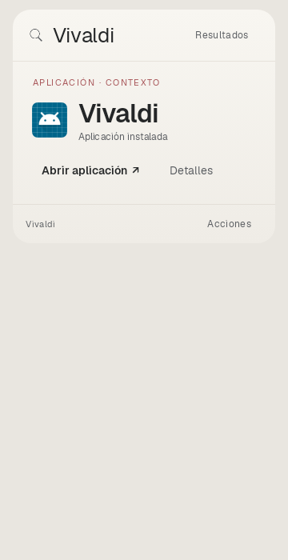](phone-light-B.png) |

La referencia es el panel de producción con flags de revisión desactivados,
renderizado en el árbol actual: no una foto física ni ejecución del APK63.
El lienzo fijo permite distinguir tamaño de ventana y fondo libre: no se agrega
espacio vacío dentro de la ventana para igualar las imágenes.

## Datos idénticos, información secundaria bajo demanda

PackageManager fixture Vivaldi/com.vivaldi.browser/Main, versión7.2-fixture e icono
Android genérico; no icono comercial obtenido externamente ni sesión real de app.
El motor de producción resuelve Vivaldi; CompactResults y ProductVisibility
existentes eligen los mismos2 resultados iniciales que el panel63, en el mismo
orden. El test compara sus IDs contra los nodos reales de la lista de referencia.
No se filtran a mano por nombre ni se reemplaza el ranking.

Las3 composiciones disponen de la misma selección, consulta, paquete, versión y
capacidades. En A/B los metadatos, información/favorita y AppCapabilityActions reales
se despliegan con Detalles/Acciones, en lugar de llenar permanentemente el inspector.
En B/teléfono los mismos resultados quedan disponibles al tocar Resultados.
La diferencia entre datos disponibles y visibles es parte del diseño, no nuevos
contenidos. La capacidad pública de búsqueda de Vivaldi del fixture no se inventa;
el componente existente conserva la indisponibilidad y el comando web alternativo.

La primera pasada de laboratorio mostraba4 candidatos crudos en A/B frente a2 en
63. Se conserva su log/XML como diagnóstico, no se publica como comparación final.
La segunda usa el presentador existente y exige igualdad de IDs/orden.

## A — superficie por bandas

Búsqueda, resultados, contexto editorial y footer pertenecen a una única superficie.
En tablet los resultados se distribuyen en una banda horizontal y el contexto ocupa
la banda siguiente completa: no hay lista izquierda/inspector derecho ni tarjeta
interior. En teléfono los2 resultados son filas planas; sigue el contexto integrado.
Abrir y Detalles se sitúan junto a la identidad. Footer de alcance/navegación,
sin keycaps ni duplicar la acción primaria. Secundarios desplegables en la misma
ventana. Tipografía Geist y acento coral pequeño en la etiqueta de contexto.

Ventajas: lectura continua, lista/contexto simultáneos y ninguna columna vacía.
Desventajas: repite identidad del seleccionado; más alto que B en teléfono;
banda horizontal requiere adaptación cuando crece el número de resultados.
Este prototipo sólo resuelve la escena acordada, no adopta reglas para otros casos.

## B — selección que transforma la búsqueda

En teléfono, contexto reemplaza la lista; el campo y la consulta se mantienen,
con Resultados visible para volver. En tablet conserva un índice lateral acotado
con2 resultados y un escenario editorial más ancho; no tarjeta interior ni
metadatos permanentes. Abrir se integra en el contexto, footer sólo Acciones.
Volver restaura el estado de resultados y foco, sin otra ventana.

Ventajas: menor altura contextual en teléfono, prioridad clara a la acción y
menos repetición. Desventajas: teléfono requiere volver para comparar resultados;
la adopción futura debe preservar selección/scroll/borradores/IME en transiciones.
No se declara resuelta esa integración global por renderizar un prototipo aislado.

## Interacciones del prototipo y límites funcionales

Los controles visibles están conectados a estado o callbacks: selección, retorno,
Detalles, información, favorita y Abrir. El test captura el Result original emitido
por Abrir, y verifica callbacks de información/favorita, consulta/foco al volver,
y Tab/Escape del prototipo. AppCapabilityActions usa su componente real, con callback
registrado por el harness. No se solicita un lanzamiento ni una acción externa.

La consulta Vivaldi se congela explícitamente en un BasicTextField readOnly para
esta comparación de una escena; no se implementa otro motor de escritura.
Estos prototipos NO son integraciones completas de los propietarios de estado/
Focus/IME/ejecución de producción. Conservar los contratos existentes significa aquí
no alterarlos ni sustituirlos. Su conexión futura, Shift+Tab, TalkBack, scroll/touch,
enter de extremo a extremo e IME requieren pruebas dirigidas tras elegir opción.
No prometer funcionalidad de producto a partir de callbacks de un laboratorio.

## Rendimiento previsto, no medido en dispositivo

Sin blur, sombra de tarjeta interior, bitmaps nuevos, shaders, red, SDK ni fuentes
adicionales (Geist/OFL ya versionada en dee1efd). Una superficie con gradiente opaco
y separadores finos. Previsiblemente menos sobrepintado que el inspector elevado
previo; no se publica un porcentaje GPU/FPS sin medición. B compone menos filas en
el contexto de teléfono; A mantiene sus resultados. Detalles añade contenido sólo
al abrirlo. No se anima la medida/altura ni se abre una ventana secundaria.

No hay métricas físicas de p50/p95, recomposición, RAM o batería. Tampoco validación
One UI/Gboard/teclado físico/TalkBack real. Las incidencias62/63 siguen abiertas.
No se genera APK ni se ejecuta Actions. Tras las8 vistas nuevas se detiene el trabajo
para elección visual del propietario, sin adopción ni extensión a otras pantallas.

## Geometría medida en Compose

Alturas del footprint, incluyendo los mismos12dp de margen superior/inferior.
La superficie pintada tiene24dp menos de alto y32dp menos de ancho que el lienzo.
Mismos valores para oscuro y claro; CSV por perfil y geometry.json preservados.

| Perfil |63 alto|A alto|B alto|Cuerpo63 dp²|Cuerpo A dp²|Cuerpo B dp²|
|---|---:|---:|---:|---:|---:|---:|
| Tablet960dp |523|366|316|362848|213440|167040|
| Teléfono360dp |572|406|316|144320|88560|59040|

«Cuerpo» es el área asignada entre búsqueda y footer: ancho interior × (alto
pintado menos chrome medido), incluye relleno/separadores y NO cuenta píxeles de
tinta ni demuestra eficiencia de información. A/B la reducen al plegar datos
secundarios y quitar la tarjeta/columna sobrante. No agrandan la ventana para
mostrar sofisticación. El espacio fuera de la ventana pertenece al lienzo fijo.
En tablet B todavía reserva espacio lateral para resultados; A elimina esa columna.

## Resultado de pruebas

4 casos distintos finales, uno por perfil, cada uno recorre63/A/B y ambas opciones:
igualdad de IDs/orden reales, aplicación exacta primero, ventana dentro del lienzo,
Abrir emite el Result original, callbacks de información/favorita, detalles con
versión real del fixture, retorno reversible con consulta/foco y Tab/Escape.
No sumar rondas previas ni cantidad de PNG como pruebas adicionales. No repetir
la suite C2 aprobada: no hay cambios en sus fuentes/ejecutores.
compile-red.log conserva el error del helper de consulta de semántica del test;
se corrigió usando contains + acceso directo, sin quitar la aserción.

Reproducir sin tareas APK/Actions:

```sh
JAVA_HOME=/workspace/tooling/jdk17 ANDROID_HOME=/workspace/tooling/sdk \
bash gradlew :app:testRaycastPreviewUnitTest \
 --tests dev.bautista.spotlight.ui.StructuralVivaldiSceneTest \
 :app:lintRaycastPreview --continue --no-daemon --max-workers=2 \
 -I scripts/directed-tests.init.gradle \
 -PspotlightDirectedClasses=dev.bautista.spotlight.ui.StructuralVivaldiSceneTest
```

Configurar proxy/truststore del laboratorio si corresponde. Icono/textos de fixture
no verifican una instalación comercial: el subtítulo del comando web que entrega
el motor incluye «app no instalada», igual que la referencia; no se corrigió ni
ocultó para favorecer el prototipo, ni se dedujeron capacidades a partir de él.

Lint final: 0 errores / 27 advertencias / 1 información.
Log final correcto en1m56s; el reporte quedó UP-TO-DATE tras el análisis porque
los hallazgos no cambiaron. No se usa la duración del laboratorio como métrica UI.
