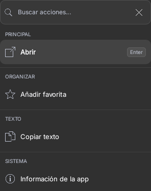
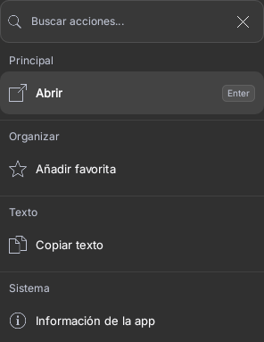
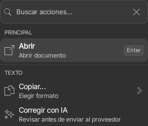
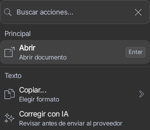

# Unslop sobre Preview 57

Base: `4fc33f2c918d3fe53a8bad7ac6571f2757630066`, recuperada de
`feat/antigravity-tablet-20261026`. Alcance: menú contextual compartido
`ActionPanelView`, en Kotlin/Compose. No es una auditoría de todas las pantallas.

## Dirección

- Producto: búsqueda local y acciones de Android, por teclado y por toque.
- Carácter: rápido, preciso, discreto.
- Mundo: paleta de comandos sobre las superficies Raycast actuales.
- Momentos: iconos reales de las apps y selección del resultado, ya existentes.
- Firma: atajos como keycaps, conservados.

## Auditoría y alcance

El sistema ya tiene superficies contenidas, selección plana, iconos coherentes,
acciones agrupadas y objetivos táctiles de 48 dp. Corresponde un pulido localizado,
sin sustituir el diseño por una plantilla ni trasladar medidas web a Android.

En `ActionPanelView`, los nombres de grupos se convertían a mayúsculas y se
presentaban a 10 sp con interlínea de 14 sp. Además no se anunciaban como encabezados
en el árbol semántico. El ajuste conserva el texto original de cada
grupo, usa 12/16 sp con mínimo de 11 sp y añade semántica de encabezado.

La sección secundaria de `SpotlightPanel` también contiene mayúsculas pequeñas;
queda fuera de esta entrega hasta contar con evidencia equivalente de ese flujo.

## Nueve pasadas

1. Espaciado: conservar tokens, densidad ajustable y objetivos táctiles existentes.
2. Color: conservar paleta, contraste y estados actuales.
3. Iconos: conservar el sistema nativo y los iconos reales de aplicaciones.
4. Texto: nombres de grupos en su escritura original, sin convertir a mayúsculas.
5. Tipografía: encabezados de 12/16 sp, mínimo 11 sp; verificar texto ampliado.
6. Composición: mantener grupos, orden, filtro, scroll y acciones.
7. Detalles: exponer encabezados para navegación asistida; conservar keycaps.
8. Visuales: no añadir imágenes decorativas a una herramienta de búsqueda.
9. Movimiento: conservar las preferencias y el comportamiento existente.

## Evidencia

Antes: dos casos dirigidos correctos, sin fallos, errores ni omitidos; código
productivo idéntico a la base. Después: los siete casos únicos de
`ActionPanelKeyboardContractTest` correctos, sin fallos, errores ni omitidos.
Los dos casos iniciales son parte de esos siete; no se suman como nueve casos.
Se conservan aserciones de navegación, foco, filtrado, identidad, callbacks y
objetivos táctiles de 48 dp. Las aserciones de texto reflejan la escritura nueva
y se refuerzan con semántica de encabezado y visibilidad.

| Escena equivalente | Antes | Después |
| --- | --- | --- |
| Grupos y acciones |  |  |
| Densidad 85%, texto 115% |  |  |

Se inspeccionaron visualmente las capturas. Los encabezados ganan legibilidad;
las acciones y el filtro siguen completos. El menú de grupos pasa de 296×375
a 296×383 píxeles por la interlínea mayor. El fixture, el tema, el contenido y
el estado de selección son iguales en cada pareja.

### Corrección pequeña descubierta por Lint

El primer `:app:lintRaycastPreview` falló con un error
`UnusedBoxWithConstraintsScope` en `SpotlightBar.kt:190`, ya presente en la base
(el archivo era idéntico a `4fc33f2c` cuando se ejecutó ese análisis). El contenedor
no consultaba sus restricciones. Se reemplazó por `Box`, conservando modificador,
contenido y presupuesto de altura. No se añade una supresión ni una baseline.

La primera ronda de `SpotlightBarTest` mostró tres fallos por un selector antiguo
(`Fuentes de búsqueda`), mientras el botón real y otras pruebas actuales ya usan
`Opciones de Spotlight`. Se actualizaron las seis referencias al nombre vigente;
se conservaron íntegramente las aserciones de altura, ventana, texto, selección
y callbacks. Los cuatro casos de la barra pasan después del ajuste. Los XML y
logs del fallo original están en `bar-first`; el resultado correcto en `bar-final`.
Son once casos únicos entre ambas clases, no una sola suite global.

Las capturas son del componente Compose real mediante Robolectric
API 33 con gráficos nativos; no son capturas de un dispositivo físico ni prueban
WindowManager, IME, One UI o rendimiento. No se genera ni distribuye una APK
con una firma sustituta.

Comandos de validación (JDK 17.0.21, SDK/Build Tools 35, Gradle wrapper 8.10.2):

```sh
# Referencia, antes de modificar producción:
bash gradlew :app:testDebugUnitTest \
  --tests dev.bautista.spotlight.ui.ActionPanelKeyboardContractTest.actionGroupsHaveVisibleHeadingsWithoutExecutingItems \
  --tests dev.bautista.spotlight.ui.ActionPanelKeyboardContractTest.densityAndTextScalePreserveMinimum48dpTouchTargetsInActionPanel \
  -I scripts/directed-tests.init.gradle \
  -PspotlightDirectedClasses=dev.bautista.spotlight.ui.ActionPanelKeyboardContractTest

# Regresión tras el cambio:
bash gradlew :app:testDebugUnitTest \
  --tests dev.bautista.spotlight.ui.ActionPanelKeyboardContractTest \
  -I scripts/directed-tests.init.gradle \
  -PspotlightDirectedClasses=dev.bautista.spotlight.ui.ActionPanelKeyboardContractTest
```

Logs y XML de ambas rondas conservados junto a las imágenes. El primer intento
de preparación falló antes de ejecutar pruebas porque el runtime original era
un JRE sin compilador; se instaló un JDK 17 verificado por SHA-256. No se redujo
ninguna aserción ni se alteró el toolchain del repositorio.

Método: [unslop](https://github.com/heydamir/unslop), creado por Damir Sokolovsky
([@heydamir](https://x.com/heydamir)), CC BY 4.0. Se aplican sus criterios de
pulido respetando el contrato nativo y las decisiones existentes del proyecto.

Lint final `:app:lintRaycastPreview`: BUILD SUCCESSFUL en 2m24s; 0 errores, 26 advertencias y 1 información. Se conserva el informe XML completo; no se desactivó ninguna regla.
