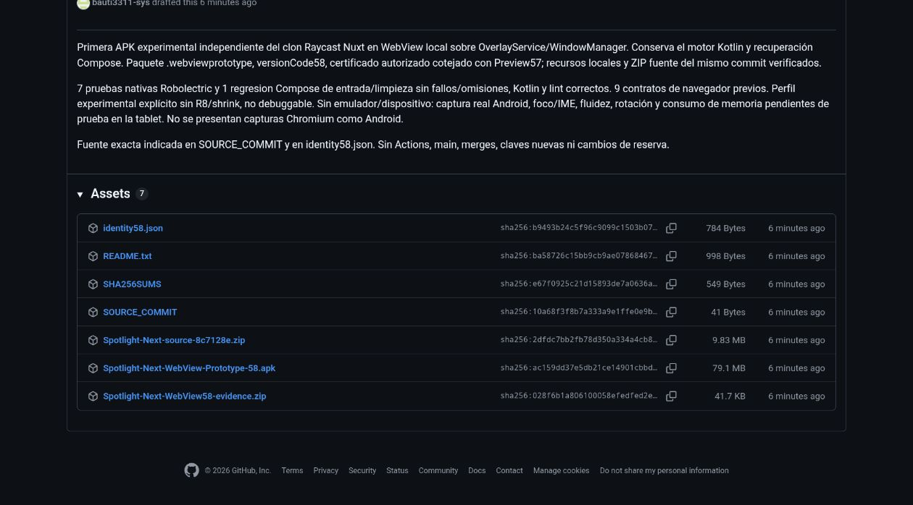

# Spotlight Next — Raycast WebView Prototype 58

**APK generada, firmada y entregada privadamente. Validación física pendiente.**

- Fuente exacta del APK y ZIP: `8c7128e75399ea4518e2df759a8a4caeab2e2073`.
- [Entrega privada con los siete archivos](https://github.com/bauti3311-sys/Spotlight-Next/releases/tag/untagged-00429816da1e44df8406).
- Rama: `feat/nuxt-webview-recovery-20261028`. El commit de documentación posterior no cambia la fuente congelada del APK.

## Archivos verificados

| Archivo | Bytes | SHA-256 |
| --- | ---: | --- |
| [Spotlight-Next-WebView-Prototype-58.apk](https://github.com/bauti3311-sys/Spotlight-Next/releases/download/untagged-00429816da1e44df8406/Spotlight-Next-WebView-Prototype-58.apk) | 82911017 | `ac159dd37e5db21ce14901cbbd4446528e36e9ec2e328368b5bb43d767c2e737` |
| [Spotlight-Next-source-8c7128e.zip](https://github.com/bauti3311-sys/Spotlight-Next/releases/download/untagged-00429816da1e44df8406/Spotlight-Next-source-8c7128e.zip) | 10306485 | `2dfdc7bb2fb78d350a334a4cb886f4049d03f86ae06c160980cf24cc7a5df16c` |
| [Spotlight-Next-WebView58-evidence.zip](https://github.com/bauti3311-sys/Spotlight-Next/releases/download/untagged-00429816da1e44df8406/Spotlight-Next-WebView58-evidence.zip) | 42675 | `028f6b1a806100058efedfed2eba77a53959caea836a975c87ab7375e6ef6062` |

Los siete assets de la entrega quedaron en estado `uploaded`; tamaños y digests SHA-256 del servidor fueron cotejados con los archivos locales. También se incluyen `identity58.json`, `README.txt`, `SOURCE_COMMIT` y `SHA256SUMS`.

## Identidad y compilación

| Comprobación | Resultado |
| --- | --- |
| applicationId | `dev.bautista.spotlight.next.webviewprototype` |
| versionCode | 58 |
| ABI | arm64-v8a |
| minSdk / targetSdk | 26 / 35 |
| Certificado SHA-256 | `885838aa970e0d4ba168a2b5f3e8f1a6e7334263c34c9cbc888f5c70381a52ba` |
| Comparación con Preview 57 | Certificado idéntico; paquete diferente |
| Debuggable | false |
| Perfil | Experimental existente, R8/shrink desactivados explícitamente |
| zipalign | Correcto con páginas de 16 KiB |
| Recursos web | 14 archivos presentes y comparados byte por byte con Git |
| Entradas de producción | 279 archivos cotejados con la fuente congelada |
| ZIP fuente | Comentario Git del ZIP coincide con el SHA exacto del APK |
| Claves / credenciales | Excluidas del ZIP; no se generaron claves |

JDK17, Gradle8.10.2 y Android SDK/Build Tools35 existentes. Lint: **0 errores, 18 advertencias, 1 información**, correcto en5m53s. Ensamblado final: **BUILD SUCCESSFUL en1m58s**. `apksigner verify`, comparación del certificado histórico y `zipalign -c -P 16 4` correctos.

## Pruebas

- `LocalRaycastWebViewTest`:2 casos.
- `LocalRaycastBridgeTest`:5 casos.
- `SpotlightBarTest.capsuleAcceptsTextAndClearButtonRunsAction`:1 caso.
- **8 casos dirigidos únicos, 0 fallos, 0 errores y 0 omisiones**. Dos tareas/cohortes Android/Robolectric (API33 y28); no sumar repeticiones.
- Los9 contratos de navegador aprobados previamente se conservaron; el frontend no se reconstruyó ni rediseñó.
- El puente fue ejercitado con paquetes registrados en el PackageManager de ensayo y el SearchEngine real: búsqueda, intent explícito, información del paquete seleccionado, tokens vencidos/desconocidos, mensajes inválidos, cierre y recuperación. Estos fixtures nunca se empaquetan en producción.

Los XML, logs, configuración de compilación, firma, hashes de entradas y verificación del APK están en el ZIP de evidencia.

## Correcciones concretas y preservación

Se recuperó la compilación anterior exitosa. Una validación posterior fue interrumpida al cerrarse el daemon; la prueba Compose pendiente aprobó al repetirse de forma dirigida. El error de lint se corrigió sustituyendo un BoxWithConstraints exterior sin uso por Box, conservando la recuperación Compose y las aserciones.

El primer APK firmado no se publicó: la comparación de assets detectó que Android había omitido `_nuxt` y sólo incluía tres HTML. La corrección8c7128e modifica únicamente `webviewPrototype.androidResources.ignoreAssetsPatterns`, conserva las demás exclusiones y las otras variantes, y permite empaquetar los módulos ya generados. El APK final pasó la comparación completa de los14 recursos. Los archivos/logs rechazados se conservaron en el área aislada.

Se preservaron OverlayService, WindowManager, el motor Kotlin, el frontend aprobado, las atribuciones Apache-2.0 de HugoRCD y Compose como recuperación. Sin funciones nuevas, merges, force pushes, cambios de firma, modificaciones de main, previews anteriores o reserva ajena. No se iniciaron GitHub Actions.

## Instalación y límites

Instalar `Spotlight-Next-WebView-Prototype-58.apk`, conceder a **Spotlight WebView Prototype** el permiso de superposición y abrir su buscador. Probar una aplicación instalada, flechas/Enter, selección táctil, Ctrl+K/Actions y Escape. La recuperación Compose está en el menú inferior izquierdo.

Esta sesión no dispuso de ADB, dispositivo ni emulador Android. **No hay captura real del overlay ni comparación física con la demo.** Apertura, foco/IME, gestos, rotación/insets, fluidez y memoria en Galaxy Tab A9+/One UI siguen pendientes. Las capturas de Chromium son ensayos de navegador, no Android.

La imagen siguiente sólo acredita la entrega de archivos en GitHub; **no es una captura de la interfaz Android**.

