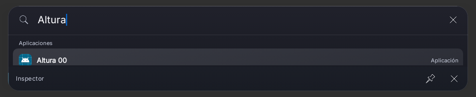
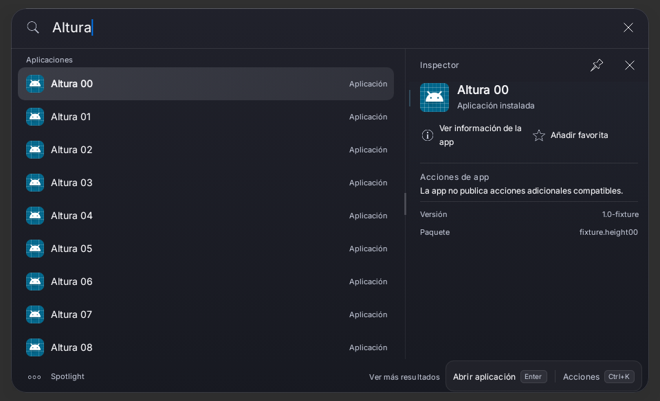
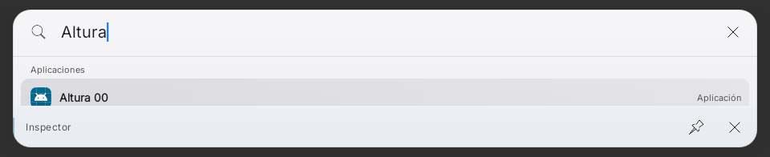
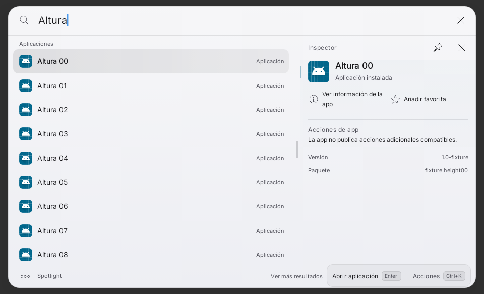
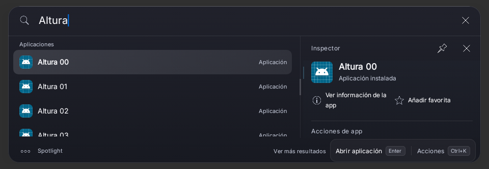
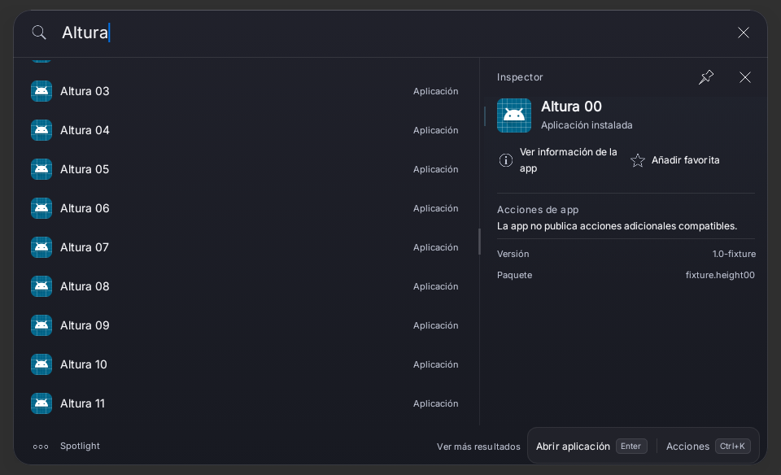
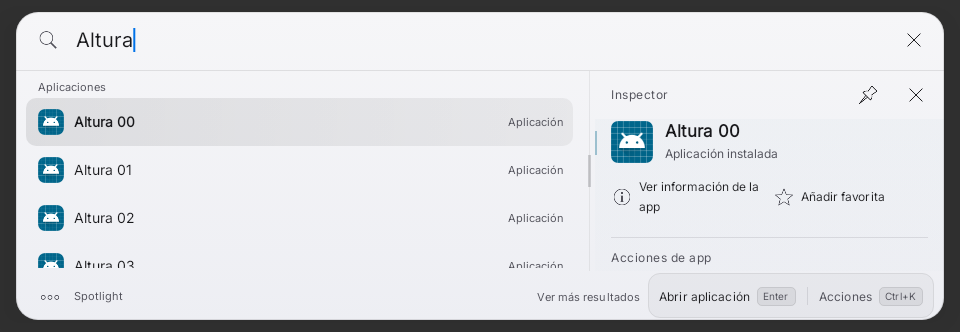
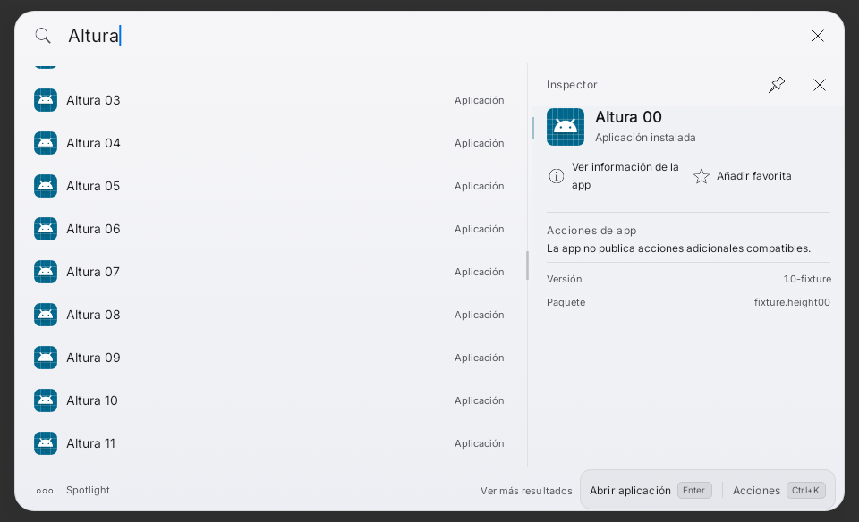
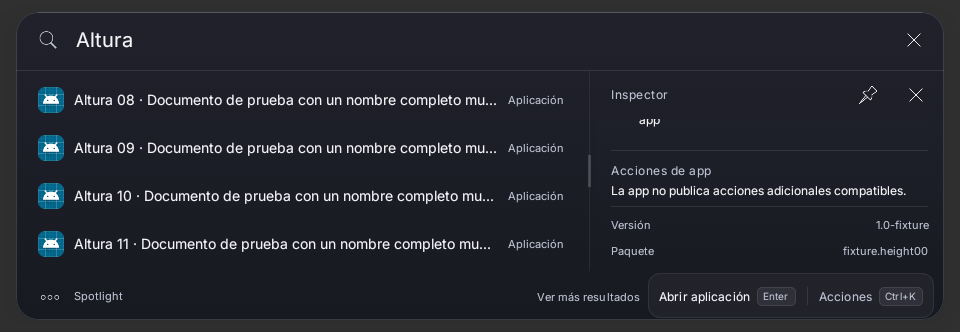
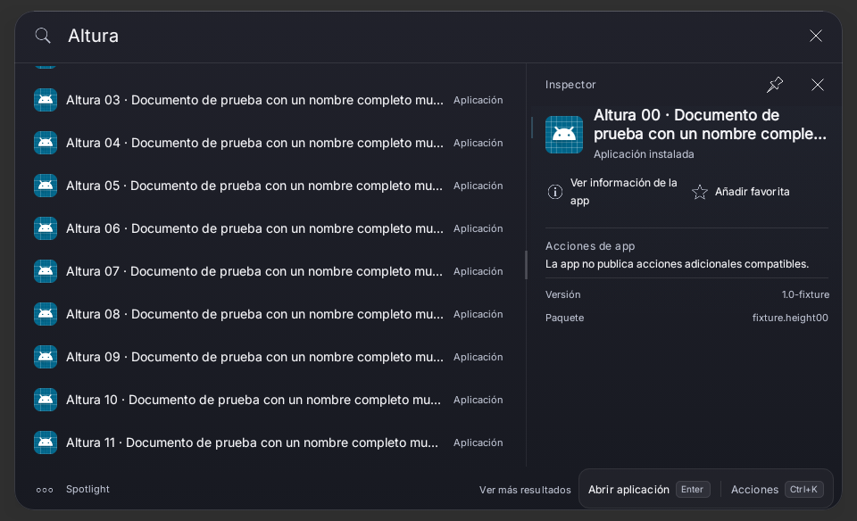

# Preview61 — recuperación de altura de ventana

Base65a9572, app funcional de APK61 fuente11b647c. Captura física aportada por el
propietario: Galaxy Tab A9+, overlay sobre Apariencia, PDF seleccionado, resultados
e inspector recortados con amplio espacio exterior; no hay teclado visible.
No hay ADB ni logs One UI en esta sesión. No se atribuye un evento concreto de
Gboard a la captura: la causa del cálculo se reproduce independientemente.

## Causa reproducida, no asumida

OverlayViewport.read comparaba WindowMetrics.height con la altura de
getWindowVisibleDisplayFrame del host. Cualquier diferencia se convertía en
frameOcclusion y además podía reducir el ancho, aunque Android informara IME
oculto. Un marco de WRAP_CONTENT/ventana acotada podía alimentar su propia altura
como un supuesto teclado en el siguiente refresco. No depende de cambiar el
ranking, Quick Look, diseño C1 ni altura máxima guardada de resultados.

Reproducción original: WindowMetrics1280×800, barras24/48px, IME oculto, marco
Rect(240,160–1040,400). Se esperaba0px de oclusión; se obtenían488px.
[XML rojo](red-initial/TEST-dev.bautista.spotlight.overlay.OverlayViewportTest.xml).
El servicio usa ese mismo viewport para el presupuesto Compose y los refrescos.

La primera escena con ese marco era tan pequeña que LazyColumn no componía una
fila y agotaba la espera del fixture. Se conservó el fallo inicial; para la
comparativa Compose se usó un marco340px de alto, sin modificar producción ni
la regresión original. Antes/después mantienen ese mismo fixture. Una primera
compilación del test tuvo imports WindowInsets ambiguos; se corrigió el import,
no código de producción, aserciones ni tiempos de espera.

## Corrección acotada

- WindowMetrics conserva la autoridad sobre el área ajustada. El marco pequeño
  del contenido no se convierte en teclado ni cambia el ancho.
- Los insets reales del IME tienen prioridad. Sólo si Android informa IME visible,
  ambos importes faltan y el marco cubre el ancho/origen del área ajustada se usa
  el respaldo de marco visible; no se elimina el caso de overlay ya redimensionado.
- Un evento de IME oculto elimina la altura antigua aunque conserve un importe
  no cero. Refrescar preferencias/configuración sin evento sigue reteniendo el
  último inset, conservando la corrección histórica F1.3.
- Al recuperar foco se vuelven a solicitar insets. No se cambia la política de
  foco, cierre, teclado físico, flags de WindowManager, identidad, firma o datos.

## Comparativas reales Compose

Robolectric API33 NATIVE; escena1280×900dp, panel960dp, escala1, temas existentes,
12 paquetes/iconos sintéticos, misma consulta/selección/versión de fixture.
La visibilidad y medidas de IME están simuladas con WindowMetrics, no con Gboard.
Los recortes son la raíz Compose real, sin dibujar ni editar imágenes.

| Escena | Antes, código original | Después |
|---|---|---|
| Oscuro, IME cerrado |  |  |
| Claro, IME cerrado |  |  |
| Oscuro, IME visible | — |  |
| Oscuro, IME cerrado después | — |  |
| Claro, IME visible | — |  |
| Claro, IME cerrado después | — |  |

## Verificación

39 casos distintos correctos:38 en una ronda y1caso adicional de contenido largo.
Ronda38: OverlayViewport9, OverlayImeHeight7,
OverlayStartup8, AdaptiveResultsGeometry5, ResultTouchScroll7 y escenas2.
XML en after/, cero fallos/errores/omisiones en la última evidencia de cada caso.
El caso largo alcanzó la última fila y el metadato final con swipe real sobre el
inspector: scroll0→105px y metadato241–261px dentro del viewport119–271px.
El helper semántico performScrollToNode sobre texto seleccionable no desplazó
este fixture; se conservan los primeros XML/captura y se prueba el gesto real,
sin reducir las aserciones de visibilidad ni cambiar el scroll de producción.
Capturas:  . Cubre apertura/dueños de ventana,
foco transitorio y cierre exterior, refresco sin evento, IME visible/oculto repetido,
reapertura/presupuesto, orientación de métricas, resultados/inspector/footer y
scroll sin tap ni apertura. No se ejecutó una suite global.

Comando dirigido: scripts/directed-tests.init.gradle, un worker, fork por clase,
heap Gradle2GiB/SerialGC/Kotlin in-process y test1.5GiB; JDK17.0.21, SDK35,
Gradle8.10.2. Task :app:testRaycastPreviewUnitTest con spotlightDirectedClasses
y filtros de esas6clases. No assemble, APK, firma, Actions o proveedor externo.
results.json conserva suites y hashes. Lint se registra en el cierre del bloque
técnico posterior; no se declara todavía ejecutado en este checkpoint.

## Límite físico y aceptación

Se corrigió el defecto reproducible del cálculo y se inspeccionaron capturas
nativas. Eso no prueba qué WindowMetrics/insets emitió la tablet del propietario,
ni certifica OneUI/Gboard/TalkBack/rendimiento. La APK61 instalada no cambia por
este commit; no se produce otra APK sin autorización. En próxima validación física:
abrir desde Ajustes y desde otra app, ocultar/mostrar IME varias veces, teclado
físico, vertical/horizontal, PDF largo/scroll y cierre/reapertura. Con IME cerrado
debe recuperar resultados/inspector/footer, sin tap accidental ni pérdida de foco.
