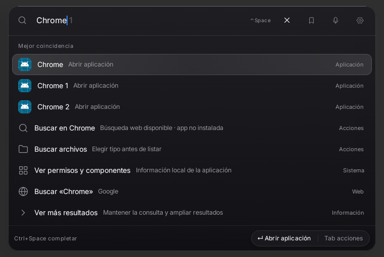
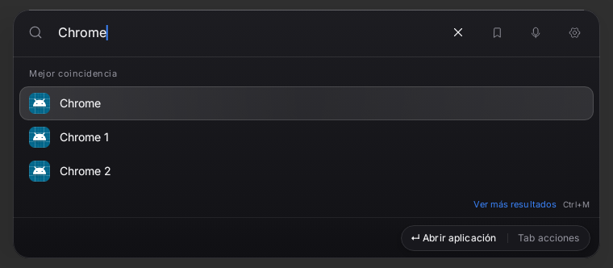
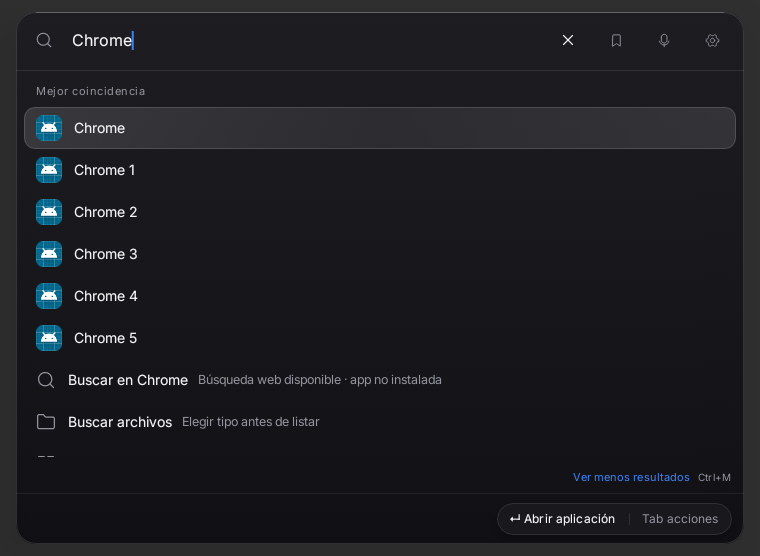
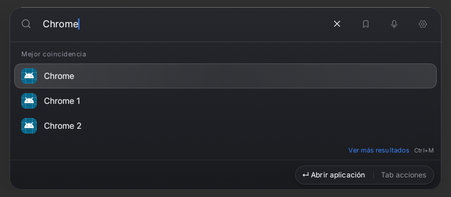
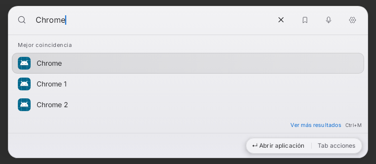

# Comparación Compose real · búsqueda compacta

Misma consulta Chrome, seis apps instaladas de fixture declaradas (sus iconos Android genéricos no son iconos de Chrome real),760dp/API33/Robolectric con gráficos nativos. Antes: renderizadores recuperados751b2a1 mediante harness separado; después: código de este checkpoint. No captura de una tablet física ni prueba de blur entre ventanas OneUI. No se sobrescribieron baselines aprobadas.

Revisión crítica: la lista inicial pasa de ocho entradas/pseudoentrada visibles a tres resultados concretos, se eliminan apertura/categoría redundantes y el autocompletado deja de sugerir otra app sobre un nombre exacto. La selección y el texto no cambian de geometría; Ver más ocupa32dp fuera de la lista y conserva todos los resultados. Permanecen los controles aprobados y la cápsula contextual. El alfa mínimo.96 reduce transparencia del resultado; verificar legibilidad/blur y teclado en OneUI después del próximo conjunto Review, sin suponer que Robolectric valida esa composición física.
